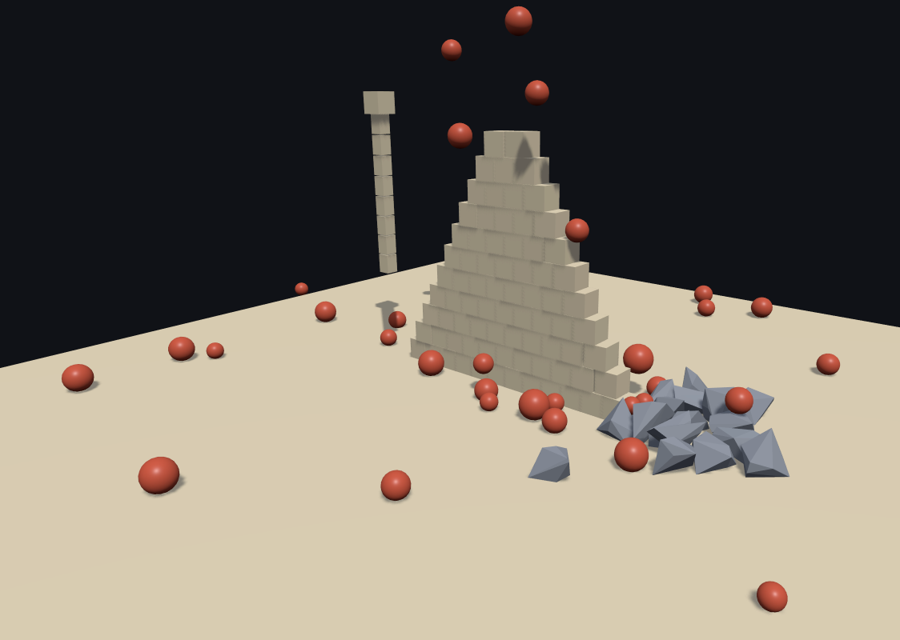

# three-avbd


GPU rigid-body physics for Three.js, implemented in TypeScript and WebGPU using
[Augmented Vertex Block Descent](https://graphics.cs.utah.edu/research/projects/avbd/).
For developers building scenes with boxes, spheres, convex hulls, friction, joints and
breakable structures; experimental non-convex SDF collisions are also available.



[Repository](https://github.com/sbobyn/three-avbd) ·
[Hosted showcase](https://three-avbd.vercel.app) ·
[Media provenance](docs/MEDIA.md)

## Status and requirements

Current source has **0.4.0 candidate APIs** and is not published. The last npm check recorded
(**November 9, 2026**) showed latest **0.3.0**, which lacks the 0.4 subpaths such as SDF; check the
registry yourself for anything newer. The frozen **review-20261106-1** snapshot has exact
source/package hashes and [verification notes](docs/REVIEW_20261106.md); `main` has moved on since,
and the hosted demo and your checkout may differ. Record the commit you run with feedback.
Keep a frozen candidate's own README with it.

Use Node **22.18+**, pnpm **10.18.0**, and a browser with a **hardware WebGPU adapter**.
The tested environment is Node 25.2.1, Three 0.187.0, Chromium/Metal on Apple M4 Max.
Minimum Node and other platforms are not separately qualified. WebGL fallback cannot run the
compute solver. Hull collisions need additional device limits; optional subgroups/timestamps
have fallbacks. [Device limits and configuration](docs/USER_GUIDE.md#physics-concepts-and-configuration).

The library is available for bounded developer review. Large-scene quality/performance,
M1/GTX 1080 targets and release qualification remain open. No CCD, native sleeping or
cross-device bitwise determinism is promised. SDF APIs are experimental.

## Get and run the demos

Choose your own parent folder. For the ordinary committed development source:

```sh
git clone https://github.com/sbobyn/three-avbd.git
cd three-avbd
pnpm install --frozen-lockfile
pnpm dev
```

For the already supplied frozen review snapshot, extract it into your chosen folder, open
a terminal there and run the same install/start commands. Its exact changes differ from main;
see [candidate identity](docs/REVIEW_20261106.md).

Open **http://127.0.0.1:5317/examples/** for the searchable demo gallery: grouped scenes,
Rapier comparisons, source links and runtime requirements. Open **/sdf.html** for the paused
SDF playground. The root URL is the large-scene showcase. If 5317 is occupied, use a free port
with `pnpm dev --port 5318` and follow Vite's printed URL. Ctrl-C stops your own server.
Serve through localhost/HTTPS, not `file://`.

No account, API key, environment file or paid service is needed. Installing dependencies
uses the registry; the demos fetch their assets. Some demo preferences/reports use browser
storage. Physics state is transient: the demos do not save editable worlds.

## First useful session — about 20 minutes

1. Open `/examples/`: try basic bodies/materials/joints, then lifecycle and body pool examples.
   Expect a box pyramid, falling spheres, convex rocks and a breakable hanging chain in basic.
2. Open `/sdf.html`, press **Play**, drag a body, drop a shape, then **Pause**. Its 12-body start
   and 36-body cap are a collision playground, not a large-scene benchmark or exact mesh inertia.
3. Follow the [fresh Three.js consumer recipe](docs/SETUP.md#fresh-threejs-consumer). It installs
   a locally built package in a new project and supplies a complete scene. The crate and sphere
   should fall onto the ground; **Kick the crate** applies an upward impulse. Change size,
   density/friction and material color separately: visual roughness does not alter physics friction.

Your durable result is the consumer's source and pinned dependency files. Reopening reconstructs
the scene; it does not restore its last simulation frame. [Save/reopen and recovery](docs/SETUP.md#keep-and-reopen-your-first-result).

For the **Rapier-first interlocking study**, open `/examples/interlocking-rapier.html`.
Then try `/examples/interlocking-avbd.html`: the same rings, peg, mass, push and rendering,
using analytic SDF contacts. Follow the [20-minute task and comparison limits](docs/PAIRED_STUDIES.md).
These are developer studies; no performance winner or new release qualification is established.
The paired study is included on `main` (original delivery: [PR74](https://github.com/sbobyn/three-avbd/pull/74)).
Use the normal source checkout above; record `git rev-parse HEAD` with your feedback.
For a frozen review, select the exact supplied commit before installing dependencies instead
of following an old PR head. This selects source, not a published package update.

For future demo choices, see the [source-linked engine and research shortlist](docs/DEMO_REFERENCES.md).
Those studies are proposals; the gallery lists implemented demos only.

## Learn and integrate

- [Core concepts, APIs, demos and configuration](docs/USER_GUIDE.md): units, fixed stepping,
 bodies, materials, forces, joints, async readback, expected behavior and limitations.
- [Fresh project, packaging, persistence and deliberate updates](docs/SETUP.md).
 Use a local built tarball for candidate 0.4: a bare Git dependency does not build its exports,
 and registry 0.3.0 lacks the new subpaths.
- [API and editable architecture/map](docs/API.md), [static queries](docs/QUERIES.md),
 [experimental SDF API](docs/SDF_WORLD.md), [SDF baking](docs/SDF_BAKING.md).
- [0.4 release/migration notes](docs/RELEASE_0.4.md), [measured findings](docs/FINDINGS.md),
 [plan/status](docs/PLAN.md), [Rapier comparison](docs/COMPARISON.md).
- [Setup troubleshooting](docs/USER_GUIDE.md#troubleshooting-and-updates) and
 [onboarding acceptance/tasks](docs/ONBOARDING.md).

For maintainers, `pnpm check` runs typecheck, CPU tests, hardware GPU tests and site/library builds.
Verification records are tied to a source version and device. The frozen review-20261106-1
snapshot recorded 255 CPU + 260 GPU tests passing on an Apple M4 Max on **November 6**, plus an
independent consumer build and bounded browser settling/impulse checks; the later
[November 7 packed-API record](docs/REVIEW_20261107.md) covers its own commit. Neither covers
today's `main`, full visual or large-scene behavior, other devices or user acceptance.
Run `pnpm check` on your checkout for current results.

## Feedback and license

Record the exact candidate, device/browser, example/settings, expected and actual behavior.
[Report a bug or friction](https://github.com/sbobyn/three-avbd/issues) or share it during review;
existing [release/consumer work](https://linear.app/sbobyn/issue/STE-3003) tracks acceptance.

MIT ([LICENSE](LICENSE)). AVBD by Chris Giles, Elie Diaz and Cem Yuksel; reference ports derive
from the authors' MIT demos. See [third-party notices](THIRD_PARTY_NOTICES.md).
