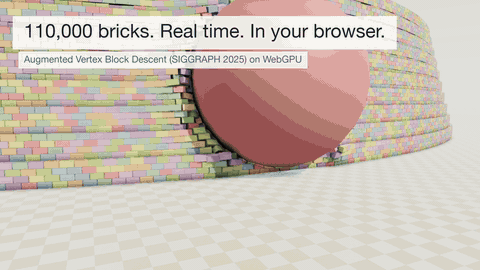

# three-avbd

[](https://www.npmjs.com/package/three-avbd)

Rigid-body physics on the GPU, in the browser: an implementation of *Augmented Vertex Block
Descent* ([Giles, Diaz, Yuksel — SIGGRAPH 2025](https://graphics.cs.utah.edu/research/projects/avbd/))
in TypeScript, Three.js and WGSL compute. Hundreds of thousands of bodies with contacts,
friction and joints, stepped entirely on the GPU and drawn straight from the solver's buffers.

**Live demo: [three-avbd.vercel.app](https://three-avbd.vercel.app)** ·
[2D demo](https://three-avbd.vercel.app/2d.html) ·
[Results vs the paper](https://three-avbd.vercel.app/results.html)

**Built with it: [Voxel City](https://three-voxel-destruction.vercel.app)**, a Teardown-inspired
destructible city of 94,000 voxel bodies ([code](https://github.com/sbobyn/three-voxel-destruction)).



Needs a browser with WebGPU: Chrome or Edge on any platform, Safari 26 on macOS and iOS,
Firefox where it ships WebGPU. Nothing is baked: every scene is simulated live on your GPU.

The unpublished 0.4 candidate adds masked body commands, lifetime observations, static
queries and capability preflight. See [capabilities and migration](docs/RELEASE_0.4.md)
and [audit dispositions](docs/AUDIT_DISPOSITION.md) before upgrading.

## three-avbd or Rapier?

**[three-avbd vs Rapier](docs/COMPARISON.md)**: features side by side, the measurements so far,
the cons and how to shrink each one today. In short, why three-avbd (M4 Max, sources in that page):

- **Scale.** A 110,000-brick ring steps in 9.3 ms headless (10.4 ms in Chrome), 4 iterations. On a 9,132-body ring,
  Rapier 0.21 took 67 ms a step and three-avbd 2.1 ms (serialized, 4 iterations each; neither met
  the shared quality target).
- **No copy to draw.** `BodyMesh` renders straight from the solver's GPU buffer.
- **Structures that break and bend.** Breakable and plastic joints run on the GPU; Rapier has
  neither built in.
- **Churn without allocation.** Fixed-storage body pools acquire, release and step with no new GPU
  buffers or pipelines.

Where Rapier is better: small scenes (at 1,000 resting boxes it was slightly faster per step and rested tighter), sleeping,
CCD, more joint types and shapes, character and vehicle controllers, synchronous queries,
cross-machine determinism, and it runs without WebGPU.

## Experimental SDF collisions (0.4 release candidate)

The experimental `three-avbd/sdf` entry point is included in the 0.4 release candidate;
published 0.3.0 does not contain it. Its API may change. It provides mesh-to-voxel baking,
analytic/voxel sampling, mass properties and curvature seeds, plus a cancellable
worker helper. [CPU baking/API usage](docs/SDF_BAKING.md) feeds the experimental
[`World.enableSdfCollisions()` API](docs/SDF_WORLD.md): automatic GPU candidate
spatial filtering, runtime body/field refresh, automatic capacity growth,
independent normals and warm starts.
Pair-level contact events and bounded SDF surface raycasts are supported.

Run `pnpm dev` and open `/sdf.html` for the interactive SDF playground: rings,
twisted solids and a mesh-baked gear pile. Start with **Play**, grab a body with
left-drag, right-drag to orbit, or drop another shape. It starts paused with 12
bodies and caps spawning at 36. Rendering follows the browser's animation frames;
physics retains its fixed timestep and bounded catch-up. Hidden tabs pause, and
paused views stop rendering once camera motion settles. Contact points/normals are
an optional throttled readback; body drawing reads the GPU buffer directly.
Mass/inertia use box proxies, so this is a collision playground, not a paper benchmark.

Open `/sdf-gears.html` for a contact-driven gear train. One motorized input drives
20/12/28-tooth gears through baked SDF collisions; follower rotations are not scripted.
Drag the gold gear or handwheel, reverse the motor, and toggle the contact-load overlay.
Disabling tooth collisions resets the train with stationary followers as a negative control.
The gears use polygon-integrated mass/inertia and two ball joints per follower axle.
See [gear-demo validation and limitations](docs/SDF_GEARS.md).

Open `/sdf-released.html` for eleven scenes using the released resolution-100 fields,
original geometry, poses, mass and full inertia: box/gear stacks, plain and distorted
planks, chairs, cows on spikes, bunnies, a spiky wheel and analytic primitives.
Default **smooth playback** runs without per-substep reference readbacks. Expand
**Reference comparison** to reset into the bounded six-second diagnostic mode with
CPU-reference metrics; that mode is for numerical inspection, not FPS measurement.

The playground and reference-scene pages offer **Measure 4s**: one second of warmup, four seconds of visible browser
frame intervals, then automatic pause. The report separates frame cadence from simulation
speed and records final GPU drain time; **Save JSON** exports the raw intervals and context.
Package scope and release instructions are in [the 0.4 release notes](docs/SDF_RELEASE_0.4.md).
Current local desktop results, verification and release boundaries are in
[SDF demo release notes](docs/SDF_DEMO_RELEASE.md). These are short observations on one device,
not a promise of 60 FPS across browsers or a reproduction of paper GPU performance.
See [API & limitations](docs/SDF_WORLD.md) and
[released-scene comparisons](docs/SDF_RELEASED_COMPARISON.md).
See [paper reproduction status](docs/SDF_REPRODUCTION_STATUS.md) and
[research reconciliation](docs/SDF_RECONCILIATION.md) for historical evidence and acceptance limits.

`three-avbd/queries` provides CPU-only static triangle BVHs, nearest rays, bounded sphere
and capsule overlaps and translational sweeps, with no GPU or Three runtime import. See
[static queries](docs/QUERIES.md) and the [Node projectile example](examples/static-projectile.ts).
These queries are independent of solver collisions and GPU bodies.

## Use it in your project

[three-avbd on npm](https://www.npmjs.com/package/three-avbd):

```sh
npm install three-avbd three
```

```ts
import * as THREE from 'three/webgpu';
import { World, BodyMesh } from 'three-avbd';

const renderer = new THREE.WebGPURenderer();
const world = await World.create({ renderer, maxBodies: 50_000 }); // y-up, gravity -9.81

world.addBox({ size: [40, 1, 40], position: [0, -0.5, 0], fixed: true });
const crate = world.addBox({ size: [1, 1, 1], position: [0, 5, 0] })!;
const ball = world.addSphere({ radius: 0.5, position: [0, 7, 0], density: 3 })!;
world.addJoint(crate, ball, { anchorA: [0, 0.5, 0], anchorB: [0, -0.5, 0], breakForce: 200 });

// Every box, drawn straight from the solver's GPU buffer (a mesh per material or shape)
scene.add(new BodyMesh(world, { bodies: 'box', material: new THREE.MeshStandardNodeMaterial() }));
scene.add(new BodyMesh(world, { bodies: 'sphere' }));

renderer.setAnimationLoop(() => {
  world.update(clock.getDelta()); // fixed steps
  renderer.render(scene, camera);
});

// Poses come back from the GPU on request (an async copy): after this, crate.position is current
await world.read();
```

- **Bodies**: `addBox`, `addSphere`, `addHull({ points })` (convex hulls; pass the renderer
  `requiredLimits: await recommendedLimits()` so they collide as hulls;
  use `World.create({ ..., requireHulls: true })` to reject unsupported devices and
  `world.capabilities` to inspect the installed collision backend), with position, rotation,
  velocity, density, friction, `fixed`;
  `body.applyImpulse(J, point)`, `applyForce(F, point)` (every step until `clearForces()`),
  `applyTorque`, collision groups (`group`, `collidesWith`), `body.moveTo(position, rotation)` (a
  fixed body as a moving platform or door, carrying what it touches), `body.set({ position, velocity, ... })`,
  `body.setFixed()`, `body.remove()` (its slot is
  reused). Adds, changes and removals go to the GPU together at the next step.
- **Joints**: `addJoint(a, b, { anchorA, anchorB, type: 'fixed' | 'ball', breakForce, breakOnPull, rest, yieldForce, breakBend })`,
  `addSpring(a, b, { stiffness, rest })`, `joint.remove()`, and `world.onBreak(joint => ...)` at
  each readback. A fixed joint can hold two bodies turned apart (`rest`: a rotation, or
  `'current'`, which takes the rotations as last read, so read first or add the joint before the
  bodies move), bend for good under load (`yieldForce`: a plastic hinge, on the GPU with no
  readback) and break once it has bent too far (`breakBend`, in radians: a `breakForce` above the
  yield only catches a sudden jump, and with `breakOnPull` it is in newtons);
  `world.readJoints()` then `joint.force` and `joint.bend` say what it carries and how far it has
  given.
- **Drawing**: `BodyMesh` takes any node material, geometry (scaled to each body's size) and
  a set of bodies (a shape, a list or a test), with `setColor(body, color)` per body.
- **Raycasts**: `await world.raycast(origin, direction)` gives the first body hit, the point and
  the normal; `world.raycasts([...])` casts many rays in one GPU pass.
- **Contact events**: `reportContacts: true` on a body and `world.onContact(e => ...)` for
  begin and end, with where, the normal and how hard (for sounds, damage, triggers).
- **Reading back**: `await world.read()` (or `world.readbackEvery = n`) for positions,
  rotations and velocities, and to learn which joints broke. `world.read(bodies)` and
  `world.track(bodies)` read only the bodies you need (160 bytes each, not the whole world).
- **Headless**: `World.create({ device })` runs without a renderer (Node with Dawn, workers).
- **Advanced**: `three-avbd/advanced` exposes the solver underneath (`world.solver`) and the
  layout of its body, joint and contact buffers and counters, for your own compute passes and
  readbacks. `appendJoints` takes each joint's own break threshold, rest rotation, yield and bend
  limit. (0.3 grew the joint record to 40 floats: stride by `JOINT_FLOATS`.)

The design and what's planned: [docs/API.md](docs/API.md). Runnable examples are indexed at
[`/examples/index.html`](https://three-avbd.vercel.app/examples/index.html) (`pnpm dev`, then
`/examples/`): [basic](examples/basic.ts), [body lifecycle](examples/body-lifecycle.ts),
[body pool](examples/body-pool.ts), and experimental SDF examples
([gears](examples/sdf-gear.ts), [balls in a torus](examples/sdf-hollow.ts),
[mesh baked in a worker](examples/sdf-from-mesh.ts)).

## What's in the demo

- **The paper's scenes.** Brick Ring (110,000 bricks, Fig. 1), Brick Walls (Fig. 3), Wall
  Smash, Breakable Wall, Chain Mail, Ragdolls on Cloth (Fig. 14), Heavy Pendulum (a 50,000:1
  mass ratio), a Flag in the Wind (pressure drag and skin friction on bodies marked as sails),
  and scale tests: Jointed Drop, box piles and Box Columns (100,000 boxes).
- **Plastic Beam**: a cantilever welded to a wall with a weight on its end. The welds are
  plastic: they hold up to a moment, bend past it and keep the bend (take the weight off and the
  beam stays bent), and the wall's weld tears under a heavy enough weight.
- **Starry Night** pours 20,000 spheres into a glass-fronted box and they come to rest as the
  painting. **Mona Lisa Tower** drops 50,000 bricks that stack into the Mona Lisa. Both lean
  on the solver being deterministic: the scene runs once off screen to find where each body
  lands, colours it from the painting there, and then runs again for real.
- **The 2D demo**: the 19 scenes of the authors' 2D demo (stacks, ropes, springs, soft
  bodies, a motor, fracture), on the CPU reference or the GPU, plus scalable box rain.
- **Custom** builds any showcase scene at a size you pick.

Controls, 3D: left-drag a body to grab it (it glows under the pointer), left-drag elsewhere to
orbit, right-drag to pan, wheel to zoom. Space, B or middle-click fires a cannonball (its
radius, mass and speed are in the scene panel, and under Settings → Advanced). P pauses, `.`
steps, R resets. 2D: left-drag grabs, right-click spawns a box, wheel zooms, shift-drag or
middle-drag pans, WASD/QE move the camera.

On a device's first visit the demo times a few solver steps off screen and remembers what
the GPU can run: a weaker GPU lands on a smaller scene, scenes that would run under 60 fps are
marked "slow here" and those under 30 fps ask before loading. Settings → Advanced measures
again.

## How it works

The whole step runs on the GPU, following the paper's Algorithm 1: a hashed-grid broadphase,
an OBB SAT narrowphase with up to eight contacts per pair, contact persistence through a hash
table (warm-started penalties and multipliers), a CSR adjacency, Jones-Plassmann graph
colouring, and then per-colour primal solves (a 6×6 LDLᵀ per body, cone friction) with a
dual update per iteration, all dispatched indirectly so the CPU never reads a count back.
Rendering is zero-copy: Three.js draws the instances from the solver's body buffer.

The GPU solvers are validated against faithful TypeScript ports of the authors' C++ demos,
which are themselves checked bit for bit against the upstream code. A seeded single step on
the GPU matches the 3D reference to 3e-6; behaviour suites cover stacking, friction, joints,
fracture and scale. Steps are deterministic on a given device, so a scene replays the same
bits every run.

Measured on an M4 Max in Chrome, against the paper's numbers on an RTX 4090:

| scene | ours | paper |
|---|---|---|
| Brick ring, 110k bricks, 4 iterations | 10.4 ms | 9.8 ms |
| Jointed drop, 34k bodies + 71k joints, 10 iterations | 6.4 ms | 16 ms (incl. cloth) |
| Brick gables, 506k bricks, 3 iterations | 25.5 ms | 17.6 ms |

Every measured decision, with how it was measured, is in [docs/FINDINGS.md](docs/FINDINGS.md);
the stages the project went through are in [docs/PLAN.md](docs/PLAN.md). The
[results page](https://three-avbd.vercel.app/results.html) compares machines; add yours from
[bench3d.html](https://three-avbd.vercel.app/bench3d.html) with "Download results".

## Running it locally

```bash
pnpm install
pnpm dev        # http://127.0.0.1:5317 (3D), /2d.html, /bench.html, /bench3d.html, /results.html
pnpm check      # typecheck + CPU tests + GPU tests (headless Dawn) + production build
```

URL parameters: `?scene=Pyramid`, `&backend=gpu` or `cpu`, `&paused`.

Benchmarks and studies, headless through Dawn (the `webgpu` package):

```bash
pnpm compare:rapier # experimental Rapier/AVBD batched-throughput comparison (Node + Dawn)
pnpm bench3d:gpu # 3D suite: the paper's large scenes and small ones (args: tiers or case names)
pnpm bench2d:gpu # 2D GPU benchmark with per-phase timing
pnpm bench2d     # 2D CPU scaling baseline
pnpm sweep2d     # iteration count: cost vs quality on the GPU
pnpm scaling2d   # box rain 10k-250k, writes docs/data/scaling2d-<adapter>.json
```

`pnpm bench3d:gpu <tiers> --json <file> --machine <name>` writes a report for the results
page (they live in `docs/data/bench3d/`). Keep a browser benchmark's tab visible while it runs.

The experimental [Rapier comparison](docs/RAPIER_COMPARISON.md) also runs at `/compare.html`
(`/compare-frame.html` for a rendered workflow). Its completed-batch timing is not a rendered FPS
comparison, and the numbers in that document are historical (see its header).

## Layout

| Path | What |
|---|---|
| `src/lib/` | The npm package's public API: `World`, `Body`, `Joint`, `BodyMesh` (`three-avbd`), and `three-avbd/advanced` |
| `examples/` | Small runnable examples of the package |
| `src/avbd3d/gpu/` | 3D WebGPU solver: WGSL broadphase, OBB narrowphase, 6-DOF solve; shares the 2D colouring kernels |
| `src/avbd3d/ref/` | 3D CPU reference: faithful port of `avbd-demo3d` (quaternions, 6x6 LDLᵀ, OBB SAT, cone friction) |
| `src/avbd3d/sim.ts` | `Sim3D` interface the 3D app drives (CPU reference or WebGPU); scene registry |
| `src/avbd3d/bench-scenes.ts`, `shapes.ts` | Showcase and benchmark scenes; spheres, sails and convex hulls (GPU-only) |
| `src/avbd3d/hull.ts`, `gpu/wgsl-hull.ts` | Convex hulls: CPU hull, faces and principal-frame mass properties; GPU SAT (Gauss-map edge pruning) and face clipping against hulls, boxes and spheres |
| `src/avbd3d/painting.ts`, `tower.ts` | Starry Night and the Mona Lisa Tower |
| `src/avbd3d/bench-cases.ts`, `src/bench3d`, `src/results` | 3D benchmark suite, its browser page and the results page |
| `src/app3d/` | 3D demo app: z-up orbit camera, shadows, zero-copy instancing, drag, cannonballs |
| `src/avbd2d/ref/` | 2D CPU reference: faithful port of `avbd-demo2d` (the oracle for the later solvers) |
| `src/avbd2d/soa/` | GPU-shaped CPU solver: SoA buffers, grid broadphase, colouring, CSR (the GPU's template) |
| `src/avbd2d/gpu/` | 2D WebGPU solver: WGSL kernels, host code, `Sim2D` adapter |
| `src/app2d/`, `src/bench2d` | 2D demo app and benchmark page |
| `src/ui/` | Shared UI: scene menu and panels, title card, device budget, build progress |
| `tests/`, `tests-gpu/` | `node --test` suites; golden trajectories from the C++ demos in `tests/fixtures`; GPU tests on a real device through Dawn |
| `tools/` | The C++ oracle build, the determinism checker, the trailer rig |

## Credits and licences

MIT-licensed ([LICENSE](LICENSE)).

An implementation of *Augmented Vertex Block Descent* (Chris Giles, Elie Diaz, Cem Yuksel,
SIGGRAPH 2025). The CPU reference solvers are TypeScript ports of the authors' demos
([avbd-demo2d](https://github.com/savant117/avbd-demo2d),
[avbd-demo3d](https://github.com/savant117/avbd-demo3d), MIT, © Chris Giles), whose 2D
collision comes from [box2d-lite](https://github.com/erincatto/box2d-lite) (MIT, © Erin Catto).
Their notices, and three.js's, are in [THIRD_PARTY_NOTICES.md](THIRD_PARTY_NOTICES.md); the
build copies both files into the site. The paintings are public domain.

`pnpm fetch-reference` clones the upstream demos into `reference/` (git-ignored);
`tools/cpp-oracle/build.sh` and `gen2d.sh` / `gen3d.sh` rebuild the oracles and regenerate the
fixtures.
