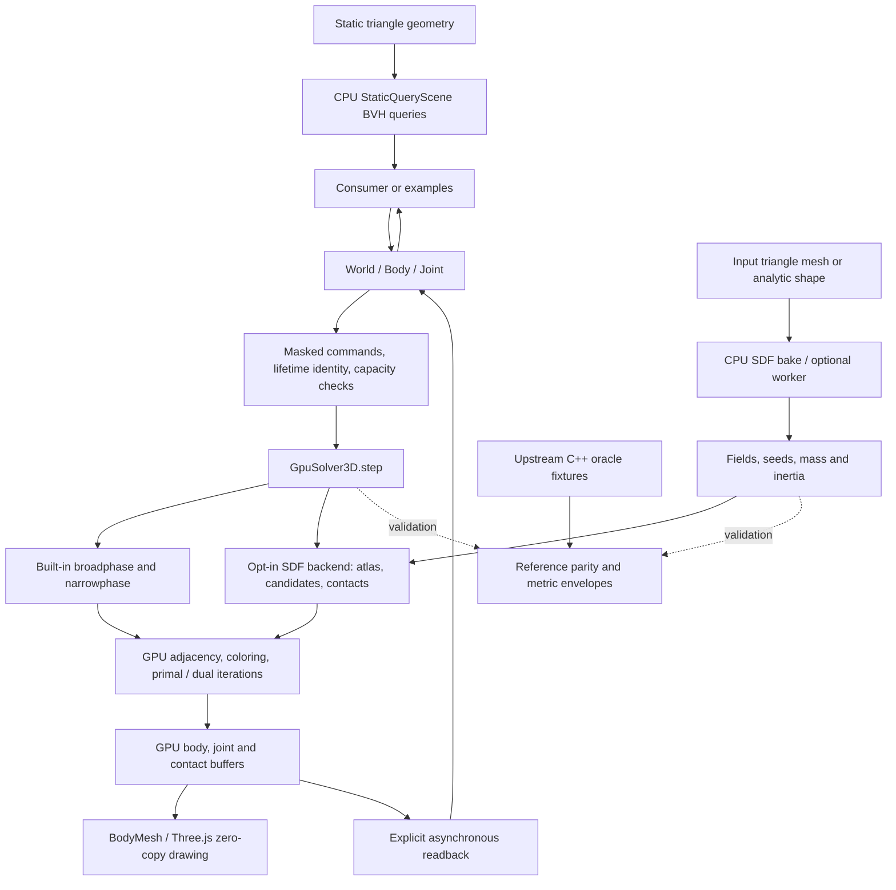
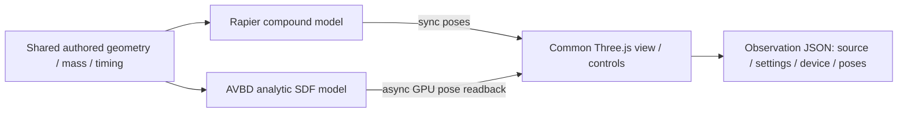

# three-avbd: library API

Status: 0.4.0. npm 0.3.0 does not include the `sdf`, `queries` or `pool` entry points.
See [0.4.0 release notes and migration](RELEASE_0.4.md), [audit dispositions](AUDIT_DISPOSITION.md)
and [historical SDF verification](SDF_RELEASE_0.4.md).

## Architecture and repository map

**Source inspection: 2026-11-05, branch `main`, HEAD
`afc1442e64e4b36f2d49be70bf35ea0c9b85cf6c`.** This describes the inspected source,
not a newly qualified release. The accompanying large-window metrics fix in
`src/comparison/final-window.ts` and regression in `tests/comparison-final-window.test.ts`
were subsequently covered by the November 6 gate (255 CPU and 260 GPU tests; no skips).
See [review verification](REVIEW_20261106.md) for the exact snapshot and tooling-update limits. Package metadata
says 0.4.0; that is not evidence of registry publication or downstream compatibility.

### Boundaries and data flow

The primary product is an in-process TypeScript/WebGPU physics library. Three.js supplies
rendering and, optionally, the shared GPU device. The site, comparison tools and research
fixtures are separate consumers/validation surfaces, not a hosted physics service.
The diagram is editable Mermaid; arrows describe source-inspected responsibilities.



- **Public state and commands:** [`World`](../src/lib/world.ts) owns body/joint handles,
  queues changes through `flush`, and advances via `step`/`update`. `read` returns
  asynchronous, step-stamped observations; CPU handle poses are not continuously synced
  GPU state. [`body-commands.ts`](../src/lib/body-commands.ts),
  [`identity.ts`](../src/lib/identity.ts) and [lifecycle contracts](BODY_LIFECYCLE.md)
  define masked writes, slot reuse and lifetime identity.
- **Compute:** [`GpuSolver3D.step`](../src/avbd3d/gpu/solver.ts) encodes collision,
  adjacency/coloring and iterative solve passes; [`layout.ts`](../src/avbd3d/gpu/layout.ts)
  is the buffer/parameter ABI. Custom `advanced` users must honor that ABI and ownership
  contract. Device capability validation lives in [`capabilities.ts`](../src/lib/capabilities.ts);
  optional timestamp/subgroup features cannot become mandatory. GPU buffers use finite
  sentinels, not infinity.
- **Rendering and observations:** [`BodyMesh`](../src/lib/mesh.ts) reads solver-backed
  storage with the same renderer/device. Contact events and raycasts cross the asynchronous
  observation boundary through [`contacts.ts`](../src/lib/contacts.ts) and
  [`raycast.ts`](../src/lib/raycast.ts). Caller-owned renderer/materials remain separate
  from World-owned storage; see the destruction contract below.
- **SDF extension:** [`src/lib/sdf.ts`](../src/lib/sdf.ts) exports analytic/voxel fields,
  baking, mass preparation and `bakeVoxelSdfInWorker`. `World.enableSdfCollisions` attaches
  [`sdf-bridge.ts`](../src/avbd3d/gpu/sdf-bridge.ts), with spatial candidate generation,
  atlas data and independent contact identities. This is opt-in and experimental; it
  replaces the built-in collision backend for that World, not a second independent world
  solver. [SDF_WORLD](SDF_WORLD.md) documents integration limits.
- **Independent CPU queries:** [`StaticQueryScene`](../src/queries/scene.ts), exported
  through [`queries`](../src/lib/queries.ts), owns a static triangle BVH. Rays and
  sphere/capsule sweeps do not automatically query dynamic GPU bodies. [`BodyPool`](../src/lib/pool.ts)
  instead manages reusable body slots in a fixed-storage World.

### Paired study consumer boundary — 2026-11-08

The Rapier-first interlocking study is an application/consumer experiment, not an AVBD public API
extension. [`interlocking-scene.ts`](../src/comparison/interlocking-scene.ts) holds shared authored
inputs and explicit convex-sector preparation; [`interlocking-rapier.ts`](../src/comparison/interlocking-rapier.ts)
owns Rapier bodies/colliders/world. [`interlocking-avbd.ts`](../src/comparison/interlocking-avbd.ts)
owns a separate public-API World with analytic SDF bindings and explicit torus mass/inertia.
The [shared view](../examples/interlocking-view.ts) owns the device/renderer/loop/UI and observation
export; only the selected engine runs. Both use ordinary meshes and CPU pose synchronization
(AVBD readback is async), so this view does not measure GPU-resident BodyMesh rendering.
The [lifecycle helper](../examples/interlocking-rapier-lifecycle.ts) bounds stepping and owns
transactional model recreation / reverse-order asynchronous teardown. Reset preserves camera/detail
and reconstructs authored inputs; observation JSON is not a restorable World. Source: PR74 base
`ec1e8c6`, branch `study/rapier-interlocking`, authored 2026-11-08; Git history identifies the
delivered revision. No solver/public interface changes.



Physical and performance acceptance remain governed by [the paired-study protocol](PAIRED_STUDIES.md).

The optional device-free [`interlocking-quality.ts`](../src/comparison/interlocking-quality.ts)
observes shared poses against analytic geometry and predeclared guards. It does not step either
engine, read device state or change the library API. Unproven compound error bands yield `unknown`;
resolved analytic centre-circle linking is not solid-body topology certification. Qualification
remains gated; see the protocol quality contract (2026-11-08, STE-3282).
The optional [bounded runner](../src/comparison/interlocking-trial.ts), invoked by
[`scripts/interlocking-trial.ts`](../scripts/interlocking-trial.ts), serializes model steps,
queue drain/readback and snapshot observers. It owns its model; the CLI owns any Dawn device.
JSON reports keep these wall spans separate and rendering unmeasured; they do not certify a
performance comparison or alter the running demo/library API.

### Initialization diagnostics — local overlay, 2026-11-07

`World.create({ renderer })` wraps renderer-init rejection with hardware WebGPU / secure-origin
context and preserves the original rejection as `Error.cause`. It does not dispose the caller's
renderer or reset/reload authored state. WebGL fallback still rejects before solver allocation.
The standalone consumer owns its renderer, so a startup failure retires that renderer and any
created World and displays the failure. Its continuous loop drops hidden-tab elapsed time,
starts/resumes with a zero delta and bounds subsequent deltas to 0–0.1 seconds. Resize refreshes
DPR with a cap of 2 (invalid DPR uses 1). These are source and device-free fixture contracts,
not new device-loss recovery, runtime/visual qualification or performance claims. Existing GPU
state/lifecycle contracts are unchanged; no solver or persistence format is added.

### Entries, persistence and assets

[`package.json`](../package.json) and [`tsconfig.lib.json`](../tsconfig.lib.json) define
five ESM/type entry points: root, `advanced`, `sdf`, `queries`, `pool`. They emit to `build/`;
the package includes build output, README, license and notices, not the site's fixtures.
[`vite.config.ts`](../vite.config.ts) separately builds `dist/`: the 3D/2D demos,
SDF showcase/gears/released scenes, comparison pages, benchmarks/results and examples.
`pnpm dev` uses strict port 5317. Attribute browser evidence to the actual source
checkout serving that port; a different running checkout is not this version.

Physics state and caches live in process/GPU memory; there is no application database,
account service or server-side world persistence in this architecture. Demo-local
`localStorage` holds device/build budgets, UI state and imported benchmark reports
([device-budget](../src/ui/device-budget.ts), [build-progress](../src/ui/build-progress.ts),
[title-card](../src/ui/title-card.ts), [results](../src/results/main.ts)). These are not
world save files. Released SDF scenes fetch Vite-emitted local fixture URLs lazily via
[`readBrowserAsset`](../src/sdf-released/assets.ts). Baking workers are local computation,
not remote services. JSON measurements/source manifests are research outputs whose
device, settings and provenance must accompany performance claims.

| Area | Responsibility / representative source |
|---|---|
| `src/lib/` | Public handles, lifecycle, rendering bridge, exports and storage policy |
| `src/avbd3d/ref/`, `src/avbd2d/ref/` | Reference/oracle implementations; SDF preparation under `ref/sdf/` |
| `src/avbd3d/gpu/`, `src/avbd2d/gpu/`, `src/avbd2d/soa/` | GPU kernels/layouts and 2D CPU SoA validation path |
| `src/queries/` | Independent CPU triangle BVH and shape queries |
| `src/app3d/`, `src/app2d/`, `src/ui/` | Interactive solver demos and shared controls/calibration |
| `src/sdf-showcase/`, `src/sdf-released/`, `src/sdf-gears/` | Bounded SDF demos; reference metrics and playback queue policy |
| `src/comparison/`, `src/results/`, `scripts/` | AVBD/Rapier adapters, quality metrics, benchmark and provenance tools |
| `examples/` | Public API consumer journeys, including lifecycle/pool/SDF |
| `tests/`, `tests-gpu/`, `tools/cpp-oracle*/` | CPU/GPU checks and upstream-generated oracle fixtures; never regenerate fixtures to hide failures |
| `docs/data/`, `docs/measurements/`, `research/` | Dated raw results and retained experiments; not automatically accepted runtime behavior |
| `public/`, `tools/trailer/` | Demo assets and capture tooling; licenses/provenance remain attached |

### Related repositories, reuse and gaps

These are distinct repositories, not a proposed consolidation:

| Repository / boundary | Observed relationship and limits |
|---|---|
| [three-avbd](https://github.com/sbobyn/three-avbd) | Library and reference/demo infrastructure described here; MIT package, Three peer `>=0.186.0`, development baseline Three 0.187.0. Peer range is not proof of every version being tested. |
| [three-destruction](https://github.com/sbobyn/three-destruction) | Separate consumer. Its inspected `packages/destruction/package.json` pins dev AVBD 0.3.0 and optional peer `>=0.3.0 <0.4.0`; the 0.4.0 pair needs exact-artifact qualification, not a silent dependency bump. |
| [avbd-ship-demo](https://github.com/sbobyn/avbd-ship-demo) | Separate Windward demo. Inspected main `83b25adb24f671e93a55683913ca9a794dc0f613` vendors solver revision `b3675de` plus ship changes, and uses Three 0.186.0. It is not a consumer of this HEAD's package; its README defines the approximation and asset limits. |

**Reuse candidates, not integration commitments:** CPU `queries` can serve static scene
queries without a GPU; cost is explicit geometry ownership/updates and no dynamic-body
coupling. `sdf` preparation/worker utilities can serve mesh-field workflows; cost is
baking memory/time, units/inertia decisions and experimental API compatibility. `pool`
and lifetime-safe readback can support destruction churn; downstream packed-consumer
tests must establish version/ABI compatibility. Do not replace Windward's vendored engine
without separate rigging/cloth/rendering qualification.

Licensing follows [`LICENSE`](../LICENSE) and [`THIRD_PARTY_NOTICES.md`](../THIRD_PARTY_NOTICES.md),
including upstream research/assets and the development-only Rapier comparison dependency.
Windward's asset manifest/notices remain in its own repo. Shared capability does not grant
asset redistribution rights. Local recovery logs, deployment association files and captures
are not public package inputs; keep them out of documentation uploads and releases.

Known gaps: #70's witness protection and #71's start-at-rest trials remain experimental;
large-scene quality/performance and current canonical interactive use are not established
by this static map. The [reconciliation](SDF_RECONCILIATION.md),
[release handoff](RELEASE_0.4.md) and [comparison status](COMPARISON_TEST_STATUS.md)
remain the detailed evidence, with their dates and limits intact. November release direction
is draft until Steven's hands-on use. No new architecture or service is proposed by this map.

## Goal

Let a Three.js WebGPU project add GPU rigid-body physics in a few lines: boxes and spheres,
joints that can break, tens of thousands of bodies drawn straight from the solver's buffer. 3D
only. The 2D solvers and reference demos stay in the repo. The advanced entry point and SDF
preparation API also include the reference utilities they depend on.

## Package

- `three-avbd` on npm. ESM only, with type declarations. Peer dependency `three >= 0.186` (it
  uses `three/webgpu` and `three/tsl`). No other runtime dependencies.
- **`three-avbd`**: the stable surface described below (`World`, body and joint handles,
  `BodyMesh`).
- **`three-avbd/advanced`**: the escape hatch. It exports `GpuSolver3D` (with the reference
  `Solver`, `Rigid` and `sphere` it's seeded from), the body and joint buffer layout, the contact and manifold record layout and the counters, hull shapes (`hull`, `convexHull`, `hullFromTriangles`), a decoder for a joint read back (`decodeJoint`), and the device and buffers of a `World`, for people writing their own compute
  passes over the bodies (the voxel city's blast shader). No stability promise in 0.x.
  **Breaking in 0.3:** a joint record is `JOINT_FLOATS` = 40 floats, not 32 (it gained the rest
  rotation, `J_REST`, the rest it started with, `J_REST_START`, a yield word, `J_YIELD`, and a bend
  limit, `J_BREAK_BEND`): code reading the raw joint buffer (`readJoints`) must stride by the
  exported constant.
- **`three-avbd/sdf`**: experimental analytic/voxel fields, baking, curvature seeds, mass/inertia
  preparation and collision parameters; see [baking](SDF_BAKING.md) and [World integration](SDF_WORLD.md).
- **`three-avbd/queries`** (new in 0.4.0): CPU-only static triangle queries (`StaticQueryScene`,
  `boxMesh`): nearest rays, sphere/capsule overlaps and translational sweeps, with no GPU or Three
  runtime import; see [static queries](QUERIES.md).
- **`three-avbd/pool`** (new in 0.4.0): `BodyPool`, fixed-template
  pools in a fixed-storage World (`WorldOptions.storage`); see [Body pools](BODY_LIFECYCLE.md#body-pools).
- Built by `tsc` from the five public entry points and their transitive dependencies into `build/`
  (the site builds to `dist/`). The tarball includes that runtime, declarations, README, license
  and third-party notices. Demo assets, benchmarks and test fixtures are excluded.

## Core API

```ts
import * as THREE from 'three/webgpu';
import { World, BodyMesh } from 'three-avbd';

const renderer = new THREE.WebGPURenderer();
await renderer.init();
const world = await World.create({ renderer, maxBodies: 50_000 }); // y-up, gravity [0, -9.81, 0]

const ground = world.addBox({ size: [40, 1, 40], position: [0, -0.5, 0], fixed: true });
const crate = world.addBox({ size: [1, 1, 1], position: [0, 5, 0], density: 1, friction: 0.5 });
const ball = world.addSphere({ radius: 0.5, position: [0, 8, 0], velocity: [0, 0, -3] });
const weld = world.addJoint(crate, ball, { anchorA: [0, 0.5, 0], anchorB: [0, -0.5, 0], breakForce: 500 });

scene.add(new BodyMesh(world, { material: new THREE.MeshStandardNodeMaterial() }));
renderer.setAnimationLoop(() => {
  world.update(clock.getDelta()); // fixed steps from an accumulator
  renderer.render(scene, camera);
});
```

### World

Activation/reset (new in 0.4.0) and its GPU/lifetime semantics are described in
[Body lifecycle](BODY_LIFECYCLE.md).

- `World.create({ renderer | device, maxBodies, gravity?, dt?, iterations? })`. With a renderer,
  it uses the renderer's GPUDevice, which zero-copy drawing requires. With a bare `device` it
  runs headless (Node with Dawn, tests, workers).
- `maxBodies` fixes the body buffer's size; adds past it fail and return `null`. Contacts,
  pairs, joints and colours grow on their own, through the existing `adapt()` readbacks.
- `step()` advances one fixed step. `update(seconds)` runs the steps that time is owed, at
  most `maxSubsteps` (default 4).
- For explicitly managed substeps, `step({ reuseManifolds: true })` skips new collision
  detection and refreshes the preceding contact set's separation and warm-start data.
  Call ordinary `step()` at the start of **every frame**, e.g. with `dt = 1/120`,
  `world.step(); world.step({ reuseManifolds: true });` advances 1/60 s. `update()`
  continues detecting on every step. This opt-in changes results: new impacts and changing
  contact normals wait until the next detecting step. It is not continuous collision
  detection; leave it off for fast projectiles or rapidly rotating contacts. Body/filter/
  constraint rewrites and queued kinematic moves force fresh detection. Advanced callers
  writing GPU buffers directly must request a detecting step themselves. The same option
  is available on `GpuSolver3D.step`. During reuse, `readPairs()` and the `pairs` counter
  retain the last detecting step's broadphase results; contact counts describe the current step.
- `params`: `gravity` (a vector, default `[0, -9.81, 0]`), `dt`, `iterations`, and the solver's stiffness
  terms (`alpha`, `betaLin`, `betaAng`, `gamma`), with the paper's defaults.
- `destroy()` releases the GPU buffers. After it, `step`, `update`, adding or removing bodies and
  joints (also through retained `Body`/`Joint` handles), `read`, `readJoints` and `raycasts`
  throw or reject with "World destroyed"; a read in flight at `destroy()` rejects without
  applying anything. Calling `destroy()` again does nothing. Handle setters (`body.set`,
  `applyImpulse`, ...) also throw before changing CPU-side state. Raycasts submitted before
  destruction may still resolve with their captured inputs and body identity.
- `error` is null until device loss or an automatic counter/body read fails. Automatic reads
  retain the failure instead of rejecting without a caller; later GPU work throws or rejects.
  Applications should check `world.error` even while paused, show the error, destroy the old
  world and recreate the device/renderer and world. There is no automatic device recovery.
- Renderer-backed body storage is owned by World. `destroy()` also releases BodyMesh ID and
  colour storage; disposing a mesh's `geometry` releases its ID/colour storage earlier.
  Both disposal orders are safe and idempotent. Remove meshes from the scene before reuse;
  caller-provided geometry/materials and the shared device/renderer remain caller-owned.
  The renderer bridge uses Three's attribute disposal/cache path (r186 and r187); it does not
  infer storage release from geometry or texture counters.

### Choosing settings

- **`iterations`** (default 10): more is stiffer and costs more. Tall stacks and walls hold best at
  10; 4 is the paper's large-scene setting, where walls stand unhit but fall more under impact
  ([FINDINGS 8m](FINDINGS.md#2026-09-24--stage-8m-tall-brick-walls-at-4-iterations-slow-bodies-start-at-rest)).
  `world.iterations` can change between steps.
- **Contact margin** (`world.solver.params.contactMargin`, default 0.01 m): a resting contact
  sits about this deep. 0.001 rests about 1.9 mm deep instead of 10.4 mm (one box on a floor,
  M4 Max); its effect on tall-wall stability is not yet re-measured, so the default is unchanged.
- **`maxBodies`**: the body buffer's fixed size (160 bytes a body). Adds past it return `null`;
  disabled bodies still hold slots, and every step traverses up to the highest slot used, so size
  it near the real peak rather than far above it.
- **`dt` and `maxSubsteps`**: there is no CCD, so a fast body moves `v·dt` a step unchecked; a
  smaller `dt` (e.g. 1/240 with `maxSubsteps = 8`) is the remedy for thin walls and fast shots.
- **Fixed storage** (`storage: { growth: 'fixed', ... }`): every capacity explicit, checked
  against the device before allocation and never grown. Needed for `three-avbd/pool`; no growth
  readbacks; overflow is dropped and counted rather than repaired, so size for the worst case. The
  default adaptive storage grows contacts, pairs and joints on its own and suits most scenes. See
  [Body pools](BODY_LIFECYCLE.md#body-pools).

How these compare with Rapier's defaults: [three-avbd vs Rapier](COMPARISON.md).

### Experimental SDF mode (new in 0.4.0; API may change)

`await world.enableSdfCollisions([{ body, field, scale?, rotation? }], params?, broadphase?)` installs SDF
collisions for allocated body slots. Unassigned boxes/spheres use
analytic fields. The spatial grid accepts optional `{ cellSize, maxPairs, autoGrow, maxPointsPerPair }`;
`maxPointsPerPair` (default 5, at most 20) bounds `cacheSize ≤ points−1` and `cacheSize + randomSamples ≤ points`;
World grows capacity after overflow unless `autoGrow: false`. Overflowing frames
remain incomplete; `adaptSdfCollisions()` can explicitly check/grow capacity.
GPU bounds, collision masks and joint exclusions select candidates;
contacts retain independent normals and identity-based warm starts.
`world.disableSdfCollisions()` restores normal collisions. Body additions/removals
require `await world.updateSdfCollisions(bindings?, broadphase?)` before the next
step/query. Omitted fields persist; replaced fields/recycled slots lose warm history.
`sdfCollisionsNeedUpdate`, `sdfCollisionCapacity`, and `sdfCollisionError` expose status. Contact events aggregate per pair; raycasts query SDF
surfaces, with at most 256 rays per call. Field rotation maps into the body principal frame. Explicit `massProperties: { mass, moments }` on body creation overrides dynamic proxy inertia; rendered geometry remains caller-owned. See [SDF World API](SDF_WORLD.md).

### Bodies

- `addBox({ size, position, rotation?, velocity?, angularVelocity?, density?, friction?, fixed? })`
  and `addSphere({ radius, ... })` return a `Body` handle.
- `addHull({ points | shape, ... })` (0.2): a convex hull of points (a mesh's vertices), or a
  `shape` from `convexHull(points)` shared by many bodies (one GPU record per shape). `position`
  and `rotation` place the points' own frame; the body sits at the centre of mass on its
  principal axes. Hulls collide as hulls where the device allows a ninth storage buffer per stage
  (`world.hullsEnabled`), else as their bounding box: `recommendedLimits()` gives the renderer the
  limits to ask for. `BodyMesh` draws a shape's bodies with `bodies: shape` (`hullGeometry`).
- A handle's `index` is its slot in the GPU buffer, for custom shaders. It's stable for the
  body's life (bodies are added at runtime, into a world that starts empty, so the solver's
  spatial reordering of an initial scene never applies).
- `body.set({ position?, rotation?, velocity?, angularVelocity? })` copies and validates the
  supplied fields (finite vectors; nonzero quaternions are normalized). Empty input is a no-op.
  Only supplied fields change; contacts start afresh. Migration: omitted fields now keep the
  body's current GPU state; pass every field to reset. Getters expose the last observation for
  each field, or its newer explicit assignment; a late read cannot erase a later assignment.
  `body.setFixed(fixed)` preserves the current GPU pose, changes mass/inertia and zeros velocity.
  `body.remove()` removes its joints, parks it far away and releases its slot. Absolute changes
  are batched into the next step or explicit read/raycast flush. A step flushes absolute fields,
  consumes movement targets, then applies impulses and persistent forces before solving.
- Kinematic bodies: `body.moveTo(position, rotation?)` on a fixed body slides from its actual
  GPU pose over the next update's steps (one step for a bare `step`), pushing and carrying what
  it touches. An omitted rotation keeps its GPU orientation. Reads and raycasts never consume a
  pending target. Retargeting starts at the current pose; arrival snaps the pose and zeros
  velocity after the final movement step. Dynamic `moveTo` sets the supplied pose fields instead.
  A fixed body given a velocity with `set` keeps moving (a conveyor). Only active move commands
  use the bounded command compute pass; worlds without commands dispatch no extra pass.
- Collision groups (0.2): `group` and `collidesWith` bitmasks (32 groups) on a body, or
  `body.setCollisionGroups(group, collidesWith)` later; two bodies collide when each is in a group
  the other collides with (default: group 1, colliding with all). The broadphase reads them from a
  buffer of their own (`GpuSolver3D.setFilters`), not the body record, which has no spare word.
  Raycasts take `collidesWith` too.
- Pushing (0.2): `body.applyImpulse(J, point?)` and `applyAngularImpulse(L)` act at the next
  step; `applyForce(F, point?)` and `applyTorque(T)` act every step until `clearForces()`. A
  small compute pass over the body buffer (`src/lib/push.ts`) turns each body's pushes, summed on
  the CPU, into Δv = J/m and Δω = I⁻¹ r × J with the mass, moments and pose the GPU holds, so a
  point is exact even though the CPU's poses are a readback old. (The solver's implicit step
  loses about 0.1% of a spin per step.)
- Reading back: `await world.read()` refreshes a snapshot, after which `body.position`,
  `body.rotation` and `body.velocity` are plain arrays as of that readback. Readback is async
  and costs a buffer copy, so it's explicit. A `world.readbackEvery` option keeps a snapshot
  refreshed automatically for gameplay that needs recent poses.
- Tracked readback (0.2): `world.read(bodies)` copies only those bodies' records (160 bytes
  each; runs of neighbouring slots in one copy) into a small staging buffer, where a full read
  is 16 MB at 100k bodies. The rest keep their last readback: each body remembers when it was
  last read, not the world. One read runs at a time: a `read(bodies)` call while one is in
  flight gets that read when it holds every body asked for as written by then; otherwise it
  waits for it and then reads them itself, so after it resolves those bodies are read. (Before
  the 2026-10-31 fix it returned the read in flight, which might not hold them.)
  `world.track(bodies)` (null: all) points `readbackEvery` at a subset,
  the player and what's near it, say.

`read()` returns `{ step }`, the submitted simulation step at its copy boundary (not a
capture of subsequent commands). In-flight reads coalesce only at the same submitted step
and when their bodies/writes cover the request. Newer per-field assignments survive late reads.
All World methods accepting body handles reject handles from another World.

### Queries (0.2)

- `await world.raycast(origin, direction, { maxDistance?, ignore? })` gives the first body along
  a ray and where: `{ body, distance, point, normal }`, or null. `world.raycasts(rays)` casts many
  at once (up to 65,535). Against boxes, spheres and hulls (as they collide), where the GPU has
  them after the steps taken so far; the answer comes back a frame or two later, like a readback.
- Ray results retain the queried body handle even if its slot is reused or the world is
  destroyed while the query is pending; they never resolve to its replacement. `ignore`
  accepts only handles from this World; removed handles do not exclude replacement bodies. Reads and rays do not consume pending `moveTo` targets.
- On the GPU (`src/lib/raycast.ts`): every ray against every body, the nearest hit per ray by an
  atomic minimum on the distance's bits, ties to the lowest body index, then the normal. Brute
  force, so the cost grows with rays × bodies; a pass through the broadphase grid can come later.
  `ignore` (up to 16 bodies) lets a ray start inside its caster.

### Contact events (0.2)

- `reportContacts: true` on a body (or `body.reportContacts = true` later) and
  `world.onContact(cb)`: `{ type: 'begin' | 'end', a, b, point, normal, impulse, step }` when it
  starts or stops touching another body. A begin says where (the contact points' average), the
  normal (from b towards a) and how hard (the normal impulse of the step they met in: a landing's
  is about m·v), for sounds, damage and triggers.
- On the GPU (`src/lib/contacts.ts`), after each step while any body reports: the step's pairs
  with a reporting body go into a hash set, and are checked against last step's set; only the
  changes are written out. So a resting pile costs a small pass a step, not a readback, and no
  begin or end is missed between readbacks. The events come back with the next readback
  (`read()` or `readbackEvery`), in step order. `maxContactPairs` (default 8192) sizes the sets
  and `maxContactEvents` (4096) the events kept between readbacks; `world.droppedContactEvents`
  counts event-buffer loss and events suppressed because an identity is no longer available.
- `body.id` is a readonly lifetime identity, unique within its World, monotonically allocated
  from 1 through `0x7fffffff`, never reused; exhaustion throws instead of wrapping. Bit 31 of
  the contact watch word is reserved for reporting. `body.index` remains the reusable GPU slot.
  Pair sets and event payloads use lifetime IDs, including non-reporting partners. Replacing
  a body against the same partner produces end then begin in that step. Event ordering is by
  step, with ends before begins; order within either kind is GPU-dependent. Delivery captures
  the event handles and listeners before callbacks run, so listener/body mutations affect
  subsequent batches.
- Removed identities are retained for up to eight generations per slot. A read drains only
  identities removed before its submitted step: the next step must first compare the previous
  active pair table and emit ends. A read without that intervening step cannot drain them.
  When churn exceeds the bound, unverifiable events are suppressed and counted individually
  in `droppedContactEvents`; no event is attached to a replacement. This is bounded reporting,
  not lossless event history. Worlds with no reporting bodies add no contact readback.
- Contact set overflow: more pairs touching reporting bodies at once than a set holds (about
  twice `maxContactPairs`) is counted in `world.contactSetOverflows` (readbacks that found a set
  had overflowed since the one before). Events in such a window are unreliable: a pair left out
  of a set reads as beginning again, or as ending. The world then resizes the sets before the
  next step, up to the solver's pair capacity (`solver.manifoldCapacity`, the most pairs a step
  can hold) and the device's storage-binding limit; at that bound the overflow stays counted.
  The resize is not lossless: the new sets start empty, so pairs already touching begin again
  and a pair that stops touching at that step reports no end. Unread events of the replaced
  sets are delivered with the next readback, before the new ones.

### Joints

- `addJoint(a, b, { anchorA?, anchorB?, type?, breakForce?, breakOnPull?, rest?, yieldForce?,
  breakBend? })` returns a `Joint`: `type` 'fixed' (rigid, the default) or 'ball' (held at the
  anchors, free to turn: the joint with no angular stiffness). `breakForce` is the paper's
  torque-based fracture; `breakOnPull` also breaks on linear force (the new negative-threshold
  mode), and then `breakForce` is also the limit on the pull, **in newtons** (a hanging 1 kg box
  pulls 9.81): one number for both, so it is chosen for the pull and the angular force breaks it
  at the same value. A ball joint carries no torque, so it breaks only on pull. Every joint
  carries its own thresholds: the world uploads them all in one `appendJoints` call. A
  `breakForce` that is negative or NaN throws.
- A rest rotation (0.3): a fixed joint's angle lock holds the two bodies' rotations equal, which
  twists two bodies placed turned apart toward each other (30° apart became 27°, 22° and 16° after
  10, 30 and 60 steps). `rest` is the turn to hold instead: b's orientation in a's frame as a
  quaternion `[x, y, z, w]`, so the joint holds `b = a·rest` whatever frames the bodies have, or
  `'current'` for the turn they have when the joint is added. **`'current'` does not look at the
  GPU:** it uses the rotations the world knows, as of the last `await world.read()` or as set
  since, so the bodies must not have moved since that readback (bodies that have been stepped,
  fallen or turned give the turn they had then). Read first, or add the joint before the bodies
  move. The identity is the default, and the old joint, except where the old one
  went wrong: its error took the long way round, pushing the bodies apart, when the two bodies'
  quaternions had opposite signs or were turned apart by more than 180°. It is taken the short way
  round now, for every joint (on the GPU and in the reference), so either sign of either
  quaternion holds.
- Plastic joints (0.3): `yieldForce` makes a fixed joint bend. Past that angular force (the number
  `breakForce` limits, so below it) the joint gives: in the solver's dual update its rest moves to
  where the bodies are and the force it carries is cut back to `yieldForce`, a perfectly plastic
  hinge that carries no more and keeps the bend. It swings a load with a torque of `yieldForce`
  times the joint's torque arm, |size_a + size_b|², and holds wherever the load stops, with nothing
  springing back once the load is gone. All on the GPU, no readback. `joint.bend` says how far it
  has bent (rad): the turn from the rest it started with to the one it holds. Notes: a load put on
  all at once overshoots to about twice its static demand before it settles, so give the yield that
  room; and a hinge that gives is cut back every iteration, so **a torque `breakForce` above the
  yield catches only a sudden jump**, never a load that keeps bending it (a hinge yielding at 60
  under a load asking 350 sees 86 at most: FINDINGS). `addJoint` warns once per world about a
  joint set up so (a finite `breakForce` above `yieldForce`, no `breakOnPull`, no `breakBend`). A
  load that goes on bending a plastic joint tears it with its bend limit, `breakBend` (rad, 0 to
  π, needs a `yieldForce`): the joint breaks as it yields and has then bent that far, a lighter
  load that bends it less leaves it holding (15 kg on a weld yielding at 60 and limited to 0.6 rad
  breaks at 34.5° in 59 steps; 8 kg bends it 8° and it holds). A bend is at most π, so a larger
  limit could never be reached: `addJoint` throws for it (`Infinity`, like no `breakBend`, is
  never). A weight a joint carries can tear it instead with `breakOnPull`, whose threshold is in
  newtons (the Plastic Beam demo: a weld that bends under a weight and tears off its wall under
  more). Fixed joints only (a ball joint has no angle lock to bend, and any of these options
  throws there); there is no linear plasticity.
- What a joint carries (0.3): `await world.readJoints()` (or `world.read()`, which reads the joints
  whenever one can break or yield) refreshes `joint.force`, `{ linear, angular }`: |λ_lin|, the
  force (N) holding its anchors together (a hanging 1 kg box: 9.81), and |λ_ang|, the angular
  force of its angle lock, the number `breakForce` and `yieldForce` limit (its torque is that times
  the torque arm). Both are of the last iteration of the last step. A joint that breaks has its
  stiffness zeroed on the GPU (`J_PEN_LIN + 3` and `J_PEN_ANG + 3`), which is how `read()` sees it
  and what `joint.broken` and `onBreak` report; its forces then read zero. Reading the raw
  records yourself: `decodeJoint(await world.solver.readJoints(), slot)` from `three-avbd/advanced`
  gives `{ linear, angular, broken, rest, bend }` for a slot (`bend`: how far it has bent from the
  rest it started with).
- `addSpring(a, b, { anchorA?, anchorB?, stiffness, rest? })` (0.2): the solver's springs, added
  at runtime (`GpuSolver3D.appendSprings`); `rest` defaults to the anchors' distance when added.
- `joint.remove()` (`releaseJoints`, whose slots are reused). `joint.broken` and
  `world.onBreak(cb)` report breaks seen at a readback (a broken joint's penalties are zeroed on
  the GPU); the world then releases it, so its bodies collide again.
- In the solver (`three-avbd/advanced`, 0.3): `appendJoints(joints, fracture?, linear?)` takes
  joints `{ a, b, rA, rB, angular?, fracture?, linear?, rest?, yield?, breakBend? }`: a joint's own
  `fracture` and `linear` override the call's (which stay, as defaults), `rest` is the turn to
  hold as above (`rotB = rotA·rest`, so `rest = rotA⁻¹·rotB` takes it from two bodies as they
  are, and it is the rest the joint's bend is measured from), `yield` the plastic threshold (a
  rigid angle lock only: left out `angular`) and `breakBend` the bend limit (rad, 0 to π, or
  `Infinity`: never; needs a `yield`). A call it cannot take is refused whole, before any slot is
  taken (a freed slot stays free and `jointCount` stays as it was): a body index `a` or `b` that is
  not an integer naming a body the solver has (below `bodyCount`), a `rest` that is not a rotation
  or is on a ball joint (`angular: 0`, which has no angle lock to hold it), a negative or NaN
  `fracture` (the sign is the solver's flag for `linear`: say that, not a negative force), a bad
  or misplaced `yield`, a `breakBend` that is negative, NaN or above π (a bend is at most π, so
  that limit could never be reached) or has no `yield` to bend. `World.addJoint` checks the same
  at the call (so nothing the solver would refuse is ever queued, and a flush that fails in the
  solver anyway lets go of the joints it did not place rather than leaving them to throw again at
  every later flush) and says once per world, with `console.warn`, when `yieldForce` is not below
  `breakForce`: the joint breaks before it can yield, so it never bends.

### Drawing: `BodyMesh`

- A `THREE.Mesh` that draws bodies straight from the solver's buffer (the existing
  `app3d/gpu-bodies3d.ts` technique): a storage attribute over the solver's GPUBuffer, and a TSL
  `positionNode` that places and rotates each instance. No copies, no readback.
- Options: `bodies?` (a shape, `'box'` by default, or a list, or a test; the mesh follows
  bodies as they come and go), `geometry?` (default: a unit box, or a sphere for `'sphere'`),
  and `material` (any node material; one already drawing another `BodyMesh` is copied, since each
  mesh sets its own nodes on it). A colour per body: `bodyMesh.setColor(body, color)`.
- Several `BodyMesh`es can share one world, for different materials per group of bodies.

## Decisions made (historical)

1. **Up axis: decided, y-up.** The GPU solver now has an `up` parameter, `[0, 1, 0]` by
   default, and gravity pulls against it (it used to act on z only). A solver seeded from the
   reference solver takes z-up (`REF_UP`), because the reference stays a faithful z-up port and
   its scenes, the demos, benchmarks and parity tests are built that way. The library is y-up
   throughout; `World` takes `gravity` as a vector and sets `up` and the scalar from it.
2. **Shapes in v0.1.** Boxes and spheres, which the GPU solver already collides. Capsules and
   convex hulls come later.
3. **Contact events.** Out of v0.1 (joint breaks only); in 0.2, opt-in per body and filtered on
   the GPU (above).
4. **Raycasts and picking.** Out of v0.1; in 0.2, on the GPU (above).

## What moves where

- New `src/lib/`: `world.ts` (World, Body, Joint), `mesh.ts` (BodyMesh), `index.ts` and
  `advanced.ts`. These are facades over `avbd3d/gpu/solver.ts`; the solver itself doesn't move.
- `app3d/gpu-bodies3d.ts` uses the same zero-copy technique as `BodyMesh` (with the demo's own
  looks). Moving it onto `BodyMesh` is for later; for now the placement code is duplicated.
- The voxel city moved to its own repo, `three-voxel-destruction`, and runs on
  `three-avbd/advanced`. As the API's acceptance test it found one gap: the reference `Solver`,
  `Rigid` and `sphere` a `GpuSolver3D` is seeded from, now exported there. It stays below the
  `World` because it runs its own compute pass over the bodies.

## Tests and release

- GPU tests (headless Dawn, `tests-gpu/lib.gpu.test.ts`) that use only the public API: a box
  comes to rest on the ground, a joint that breaks on pull lets go and reports it while an
  unbreakable one holds, and removed bodies' slots are reused. (0.3: a rest holds a turn through
  tumbling, a plastic cantilever bends, stays bent and tears at its bend limit, a joint's forces
  read back, and a joint that takes the slot of one removed while a readback is in flight is not
  judged by the old joint's record.)
- `BodyMesh` needs a renderer, so it's checked in the browser: `examples/basic.html` runs in the
  dev server (pyramid, raining spheres removed as new ones come, a breakable chain).
- `pnpm build:lib` then `pnpm pack`: installed into a blank Vite project, it typechecks with
  full library checking on TypeScript 5.9 (with `@webgpu/types`) and 7, and builds. The first
  publish is `0.1.0`, with the README's section on using it.

### Collision capability preflight

`deviceCapabilities(device)` is a synchronous, allocation-free, frozen snapshot of
**negotiated GPUDevice limits**. `standardHullCollisions` means the standard
narrowphase can use native convex hull SAT (nine storage buffers per shader stage).
Adapter support alone is insufficient: request the limit when creating the device,
or pass `requiredLimits: await recommendedLimits()` to Three's renderer constructor.
World and its solver use the supplied device; neither requests nor upgrades it.

```ts
const world = await World.create({ device, maxBodies: 256, requireHulls: true });
const capabilities = world.capabilities;
// capabilities.backend === 'standard'; capabilities.hullCollisions === 'native'
```

`requireHulls: true` rejects unsupported standard hull collisions before World
allocates solver buffers or renderer storage attributes. A renderer must first be
initialized to discover its actual device, so renderer initialization may itself
allocate resources. Caller devices and renderer resources remain caller-owned.
Omitting the option (or using false) preserves legacy behavior: hulls collide as
principal-frame bounding boxes on eight-buffer devices. The first successful
`addHull` using that fallback warns once per World. Hull mass and visual geometry
remain hull-derived; the warning concerns collision geometry.

`world.capabilities` returns a new frozen snapshot of the **installed** backend.
Re-read after enabling/disabling SDF; retained snapshots never change. While SDF
setup is pending, it reports the previous installed backend (operations still obey
SDF preparation guards). Failed setup retains the previous backend. The creation
option checks initial standard support, and does not prohibit later backend switches.
`standardHullCollisions` remains a device capability across those switches;
`hullCollisions` describes actual backend semantics:

| backend | hullCollisions | geometry |
|---|---|---|
| standard | native or box-fallback | Boxes, spheres and device-dependent convex hulls |
| sdf | explicit-sdf-field | Analytic boxes/spheres; hull bodies need explicit SDF bindings |
| custom | unknown | Advanced caller backend; shape support is not inferred |

`sdfFields` means the experimental SDF collision backend is installed, not that
native hull SAT is running. SDF fields replace collision geometry only; mass,
inertia and meshes remain caller-owned. `boxes`/`spheres` report built-in support
and are false (unverified) for custom backends. `capsules`, `compounds`, `sensors`
remain false: there are no native body helpers/encodings for those features. An
analytic capsule SDF field does not provide a native capsule body API.
`hullsEnabled` retains its historical meaning (standard solver hull support), even
while SDF is installed. Direct advanced backend installation is reflected as
`custom`; capabilities do not certify arbitrary shaders or device health.

A separate collider handle/view is deferred: hull poses already use principal
mass frames, and SDF bindings have independent field frames and transactional
refresh ownership. A useful view needs explicit resource/lifetime and geometry
semantics across those paths. C1 leaves existing body layouts and shape codes intact.


### Build/report provenance — 2026-11-09, STE-3003

[`git-provenance.ts`](../scripts/git-provenance.ts) feeds the Vite build constant and diagnostic
CLIs. It checks the physical checkout root, reports the Git head/dirty flag, and adds counts of
tracked/untracked/index/worktree/rename/conflict status entries without file names. The older
comparison CLI forwards these as `gitChanges`; interlocking JSON embeds the object directly.
Unavailable metadata stays unknown/null with a controlled reason. An untracked directory is one
entry, ignored files are not included, and counts do not identify the cause of hosted changes or
certify a pristine artifact. No build/CI settings, source-cleanliness exemptions or ignore rules change.
