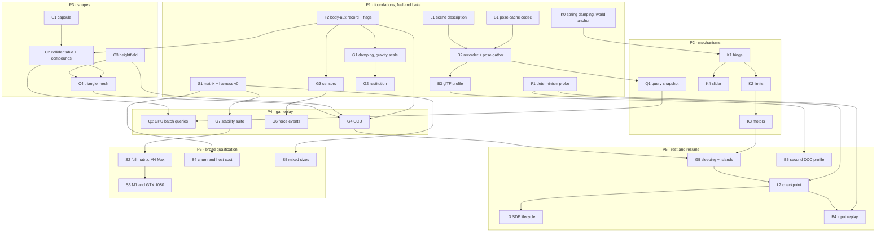

# Native feature-support roadmap — tracked programme (2026-11-10)

A route from three-avbd's current narrow engine to genuine, documented and tested support for
seven requested gap families: collision shapes, constraints, gameplay features, queries,
lifecycle and checkpoints, baking and interchange, and scale qualification.

**Steven authorized staged implementation and normal commit/PR/merge delivery on 2026-11-10.**
The initial planning request is complete. Feature/API spellings, numerical targets and methods
below remain proposals until their bounded design and checks pass. Stage labels are not
announced versions or dates; tracking does not mean implementation or release acceptance.

| | |
|---|---|
| Source | Initial analysis at main `0b48ebf`; execution base `31bb39b` after PR88. Gravity-scale code/design overlay on `feat/ste-3328-gravity-scale-public-20261110`; exact delivery/check identity in the lead receipt. Historical tables are qualified to the initial analysis. |
| When | 2026-11-10 |
| Package | `three-avbd` 0.4.0 in `package.json`, **unpublished** (registry latest 0.3.0 and 0.4.0 E404 per the lead on 2026-11-10; not rechecked here) |
| Since the round-2 audit | PRs 83–87 delivered startup diagnostics, docs, recovery fixes and uncertified research helpers. None adds a feature in this roadmap |
| Author | Fable 5.2 High planning worker, then accountable lead review; plan/receipt/home edits only, no code, tests, build, GPU, browser, Git delivery or Linear writes |
| Reused | [maturity audit round 2](audits/maturity-round2-20261109.md), [0.4 capability table](RELEASE_0.4.md#capability-summary), [COMPARISON](COMPARISON.md), [API](API.md), [QUERIES](QUERIES.md), [BODY_LIFECYCLE](BODY_LIFECYCLE.md), [SDF_WORLD](SDF_WORLD.md), [PLAN](PLAN.md). No new code audit, paper reproduction or suite run |

Statements are tagged where it matters: **[E]** evidence read from source, docs or Linear on this
date; **[P]** proposal; **[U]** unknown or unverified.

**Authorized next action:** implement the bounded first slices in section 10 under the actual
Linear map in section 4, then lead review/checks/ticket-linked PR delivery. The existing persistent
lead owns integration and preserves the live source pins.

Lead review (2026-11-10): retain the existing inherited Linear project and persistent lead; reuse
STE-3003 for F1 instead of creating a duplicate. API spellings, layout changes, error types and
numeric acceptance targets below are design proposals to validate before implementation. Relative
effort/confidence is planning judgment, not delivery evidence. Later stages do not depend on
certifying the optional STE-3282 research geometry helpers.

## 1. Answer in short

- **Linear coverage:** umbrella [STE-3326](https://linear.app/sbobyn/issue/STE-3326) now tracks
  all 33 work packages through 32 new native leaves plus the existing STE-3003/F1 probe. All
  37 gap rows have a tracking path. This is planned coverage, not implemented parity. The
  historical search below distinguishes partial consumer work from native library scope.
- **Route:** six proposed stages, with a useful mechanic or baked study where applicable and
  qualification throughout. Section 8 specifies 33 work packages, including F1 already named in
  STE-3003; they are not 33 newly created issues or promised releases.
- **Order:** materials and a real pose cache first (smallest solver change, unlocks baking), then
  joints, shapes, gameplay queries and CCD, then sleeping and checkpoints, then full
  qualification. The solver lane must serialize; queries, baking and the harness run beside it.
- **Hard limits that do not go away:** GPU state is asynchronous to the CPU; no universal
  cross-GPU bitwise determinism; finite documented capacities; M1 and GTX 1080 are unmeasured.

## 2. Definition of full support

A subfeature is **supported** only when all eight hold. Every ticket in section 8 inherits this.

1. **Public API and types** in a packaged entry (`package.json` `exports`), with input validation
   that fails before any slot, ID or GPU write (the `world-validation.ts` pattern).
2. **Capability contract** in `world.capabilities` where applicable, true only for backends that
   pass. Unsupported operations fail explicitly. A standardized typed-error API is proposed, not
   current behavior or an approved public contract.
3. **Plain Three.js consumer coverage:** a focused example or an extension of a coherent existing
   example, discoverable through the gallery, and `fresh-project` still builds. A separate card
   for every subfeature is not required.
4. **Acceptance tests:** CPU tests for pure math and validation; GPU tests on a verified hardware
   adapter for behaviour, with thresholds written before the run. Failed and raw runs are kept.
5. **Failure, lifecycle and resource policy:** behaviour on removal, disable, reset, pool reuse,
   fixed storage, overflow (counted, never silent), destroy and device loss is stated and tested.
6. **Quality then performance envelope:** a row in the qualification matrix (section 8, S1)
   passes quality before any timing is reported, with device, browser, settings and commit.
7. **Docs and migration:** `API.md` section and diagram, `USER_GUIDE.md`, `COMPARISON.md` row,
   release-notes migration lines, limits stated as numbers.
8. **Release acceptance:** packed-tarball fresh-consumer check of the new surface. Publication
   stays Steven's decision.

Finite documented limits and fail-fast are valid support. "Engineering quality check with stated
uncertainty" is the bar; mathematical certification is not required and is never implied.

Shared defaults for every ticket unless it says otherwise:
- **Default compatibility:** extensions are opt-in where appropriate. CPU oracle fixtures retain
  their existing round-off/identity contract; GPU checks retain their documented f32/order-aware
  envelopes. No blanket bitwise GPU guarantee is introduced. Removing an option is not a complete
  rollback if layouts or serialized formats changed; those need a migration/compatibility plan.
- **Evidence:** focused CPU and GPU tests, one bounded hardware run by the lead, raw output kept.
- **Oracle rule:** `src/avbd2d/ref` and `src/avbd3d/ref` defaults stay faithful ports. Extensions
  with no upstream counterpart live outside `ref/` (as spheres do) and are validated analytically.

## 3. Coverage matrix

Historical Linear class before 2026-11-10 reconciliation: **exact** (a native three-avbd ticket with this scope), **partial**,
**consumer-only** (tracked only as application glue or another engine), **missing**.
"Next" names a work package in section 8, mapped to its actual issue in section 4.

### 3.1 Collision

| Subfeature | Today [E] | Source | Linear (2026-11-10) | Next |
|---|---|---|---|---|
| Box, sphere | Supported, standard backend; analytic in SDF | `SHAPE_BOX`, `SHAPE_SPHERE` in `src/avbd3d/gpu/layout.ts` | Shipped; baseline | — |
| Convex hull | Supported, ≤ 32 vertices (`MAX_HULL_VERTICES`), needs 9 storage buffers per stage, else box fallback or `requireHulls` refusal | `src/avbd3d/hull.ts`, `capabilities.ts` | exact for that slice: STE-2206, STE-2207 (Done) | — |
| Capsule body | Absent. `capabilities.capsules` is the literal `false`. A capsule exists only in CPU static queries | donor: `src/queries/capsule.ts` | consumer-only: character-controller work in another repository; no native capsule support | C1 |
| Native compound | Absent: one shape per body. Workaround is welded bodies | `capabilities.compounds: false`; `COMPARISON.md` §7 | consumer-only: application actors/jointed clusters; STE-3282 uses Rapier compounds only | C2 |
| Subshape IDs, per-shape material and groups | Absent. Friction is one float per body (`pos.w`); groups are per body in a separate filter buffer | `layout.ts`, `GpuSolver3D.setFilters` | missing | C2 |
| Compound mass, inertia, centre-of-mass offset | Partial: `massProperties: { mass, moments }`, principal frame only, no offset | `world.ts`, `src/lib/inertia.ts` | missing | C2 |
| Static triangle mesh in the solver | Absent. CPU BVH exists but is independent of the World | donor: `src/queries/bvh.ts`, `scene.ts` | no native coverage found before reconciliation | C4 |
| Heightfield | Absent | — | no native coverage found before reconciliation | C3 |
| Dynamic concave bodies | Experimental SDF only: adaptive storage, no activation, reset or pools | `src/lib/sdf.ts`, `sdf-bridge.ts` | partial: STE-3001 umbrella, STE-3003, STE-3006, STE-3007 | C2, L3 |

### 3.2 Constraints

| Subfeature | Today [E] | Source | Linear | Next |
|---|---|---|---|---|
| Fixed, ball, spring, breakable, plastic | Supported on the GPU | `Joint`, `Spring` in `src/avbd3d/ref/forces.ts`; `appendJoints` | exact for those slices: STE-2531, STE-2279 (Done) | — |
| Hinge (true 1 DOF) | Absent. Workaround: two ball joints on an axis | `COMPARISON.md` §7 | consumer-only: hinge-like application clusters; native plastic welds are not true hinges | K1 |
| Slider | Absent | — | missing (zero hits for "prismatic"; "slider" matches only audio UI) | K4 |
| Angular and linear limits | Absent | — | missing | K2, K4 |
| Motors, torque caps | Absent in 3D. The gear demo drives one wheel kinematically with `Body.moveTo` | `docs/SDF_GEARS.md`; 2D-only donor `Motor` in `src/avbd2d/ref/forces.ts` | consumer-only: STE-3009 (Done) is that kinematic drive | K3 |
| Spring damping, world-anchored joint | Absent in `World`; the solver has an unexposed `setWorldAnchor` | `solver.ts` | missing | K0 |

The 3D upstream demo ported in `src/avbd3d/ref` has joints, springs and collision exclusion only.
**Implementing the AVBD paper does not give hinge limits, motors, restitution, sleeping or CCD**;
those are extensions with no oracle. [U] The paper text was not re-read for this plan.

### 3.3 Gameplay

| Subfeature | Today [E] | Source | Linear | Next |
|---|---|---|---|---|
| Sleeping and island wake | Absent (`nativeSleeping: false`). Consumer pattern: `setFixed` on still bodies | `COMPARISON.md` §7 | consumer-only: settle-to-static work in a downstream repository | G5 |
| CCD | Absent: discrete only. Remedy today is a smaller `dt` and CPU sweeps against static meshes | `API.md` settings | no dedicated native coverage found | G4 |
| Restitution | Absent: inelastic contacts | — | missing | G2 |
| Linear and angular damping, gravity scale | Absent | — | missing | G1 |
| Sensors | Absent: `reportContacts` still collides | `src/lib/contacts.ts` | missing | G3 |
| Contact events, force events, overflow semantics | Begin and end exist: async, bounded, lossy with counters. No force threshold events | `API.md` contact events | partial: STE-3003 documents today's bounded semantics | G6 |
| Stability acceptance (mass ratio, thin wall, step-size invariance) | One fix (pivot floor) and scattered tests; no declared suite | `tests-gpu/pivot.gpu.test.ts` | partial: STE-2219 (Done), STE-2290 (Backlog, 2D) | G7 |

### 3.4 Queries

| Subfeature | Today [E] | Source | Linear | Next |
|---|---|---|---|---|
| GPU world rays | Supported: async, batched (65,535), brute force rays × bodies | `src/lib/raycast.ts` | shipped under STE-3003; baseline | — |
| Static CPU rays, sphere and capsule overlaps and sweeps | Supported, independent of the World | `src/queries/` | shipped under STE-3003; baseline | — |
| Immediate dynamic-world query contract | Absent. Needs an architecture decision (AD-6) | — | missing | Q1 |
| Closest point, overlap, shape cast and sweep against bodies | Absent | — | missing | Q1, Q2 |
| Accelerated rays | Absent | `raycast.ts` | missing | Q2 |

### 3.5 Lifecycle

| Subfeature | Today [E] | Source | Linear | Next |
|---|---|---|---|---|
| IDs, removal, activation, reset, pools, fixed storage | Supported, standard backend only | `identity.ts`, `lifecycle.ts`, `pool.ts`, `storage-budget.ts` | shipped; baseline | — |
| The same for SDF | Absent. SDF refuses fixed storage; "do not rely on full SDF reset guarantees" | `BODY_LIFECYCLE.md`, `SDF_WORLD.md` | missing: no ticket. STE-3001 lists only atlas allocation and event follow-ups as separate work | L3 |
| Authored scene reconstruction | Glue: recreate the World from your own definitions | `SETUP.md`, interlocking reset | partial: STE-3003 records reconstruction versus unsupported state restore as guidance | L1 |
| Complete resumable checkpoint | Absent | — | no native coverage found before reconciliation | L2 |
| Schema, device compatibility, migration | Absent | — | missing | L2 |

### 3.6 Baking

| Subfeature | Today [E] | Source | Linear | Next |
|---|---|---|---|---|
| Pose capture and physics-free player | Example only, provisional schema, ≤ 300 steps, box and sphere, transforms only (PR 82) | `examples/pose-capture.ts`, `pose-track.ts`, `pose-playback.ts` | partial: STE-3003 | B1 |
| Stable cache format, chunking, cancel, recovery, provenance | Absent | — | missing: STE-3003 records that no AVBD pose-cache issue exists | B1, B2 |
| Readback cost | 160 bytes a body per read, three copies (audit M-11) | `solver.ts` `read`, `world.ts` | missing | B2 |
| Verified replay, determinism scope | [U] Same-device determinism through `World` is unverified; adaptation lands at a varying step (audit M-08). Solver-level bit-identical runs exist with fixed capacities | `tools/determinism.ts`, `solver.ts` `adapt` | partial: STE-3003 lists the probe as a next step, not a ticket | F1, B4 |
| Deterministic input replay | Absent | — | missing | B4 |
| DCC interchange | Absent. No Alembic, USD or VDB support exists or is claimed | — | consumer-only: downstream timeline/cache export work does not implement an AVBD format | B3, B5 |

### 3.7 Scale

| Subfeature | Today [E] | Source | Linear | Next |
|---|---|---|---|---|
| GPU-resident step, zero-copy drawing | Supported | `solver.ts` `step`, `src/lib/mesh.ts` | shipped; baseline | — |
| Broad quality and performance matrix | Dated single-device cases; no declared matrix | `COMPARISON.md` §3, audit §3 draft | partial: STE-3005 (Done, bounded SDF browser), STE-3007 (Backlog, SDF), STE-3282 (one paired study) | S1, S2 |
| Target hardware (M1, GTX 1080) | Unmeasured. Only M4 Max is qualified, for bounded checks | `AGENTS.md` | consumer-only: downstream acceptance is separate from library qualification | S3 |
| Capacity, overflow, fixed versus adaptive | Mechanisms exist; not qualified under load | `storage-budget.ts`, `adapt` | missing | S1 |
| Churn and host cost | Code patterns, unmeasured (audit M-10, M-11) | `mesh.ts`, `uploadStatics` | missing | S4 |
| Mixed sizes | Single-level grid; at most 64 large bodies (`MAX_LARGE`) tested against everything | `src/avbd3d/gpu/radii.ts` | missing | S5 |

## 4. Linear coverage

### Method and limits

The2026-11-10 investigation used complete scoped native-project term searches, the existing
SDF umbrella/children and selected downstream descriptions, plus22narrow searches. Some global
searches were first-page only and a cross-project filter could not be verified. This is not
workspace-exhaustive absence. Detailed other-project issue identities and recovery inventories
remain in the existing tracker/lead receipt; the public roadmap includes native-library scope.

### Counts (37 gap subfeatures, the non-baseline rows of section 3)

| Class | Count | Which |
|---|---|---|
| exact | 0 | — (baseline rows only: hulls STE-2206/2207, plastic joints STE-2531) |
| partial | 7 | dynamic concavity (SDF), event semantics, stability acceptance, scene reconstruction, pose example, replay probe, scale matrix |
| consumer-only | 7 | capsule, compound, hinge, motors, sleeping, DCC interchange, target hardware |
| missing | 23 | subshape and material, compound mass, triangle mesh, heightfield, slider, limits, spring damping and world anchor, CCD, restitution, damping and gravity scale, sensors, query contract, closest/overlap/casts, ray acceleration, SDF lifecycle, checkpoint, schema and migration, cache format, readback cost, input replay, capacity qualification, churn cost, mixed sizes |

### Dedupe rationale

- Downstream settle-to-static, jointed-actor, controller and export work is consumer work, not
  native library support. Do not move/reopen/re-scope another project's tickets.
- STE-3001 remains the SDF umbrella; STE-3003 keeps its release/consumer acceptance and F1 probe.
  General native parity lives under STE-3326 rather than expanding those scopes.
- Other cache/checkpoint designs can inform vocabulary, but do not establish an AVBD format.
- Target-device acceptance for a consumer is separate from this library's S3 qualification.
- Advanced-layout evolution requires deliberate compatibility work with the separate
  three-destruction repository; STE-2834 keeps that existing dependency boundary.

### Actual reconciliation and authorized delivery — 2026-11-10

[STE-3326](https://linear.app/sbobyn/issue/STE-3326) is the new general native-support umbrella
in the **existing inherited project**, with 32 native leaves and F1 reused under STE-3003.
No new project, lead, family-management layer or milestone was created. All leaves were read back;
the initial In Progress leaves were F2 and B1, followed by G1 after its design gate. STE-3003 keeps its existing parent and acceptance.

| Package | Actual issue | Scope | State at reconciliation |
|---|---|---|---|
| F1 | [STE-3003](https://linear.app/sbobyn/issue/STE-3003) | Probe same-device determinism through World | Existing In Progress |
| F2 | [STE-3327](https://linear.app/sbobyn/issue/STE-3327/three-avbd-f2-body-auxiliary-record-and-feature-flag-pattern-design) | Body auxiliary record and feature-flag pattern (design note, then code) | In Progress — bounded first slice |
| G1 | [STE-3328](https://linear.app/sbobyn/issue/STE-3328/three-avbd-g1-linear-and-angular-damping-gravity-scale-dropped-time) | Linear and angular damping, gravity scale, dropped-time counter | Backlog |
| G2 | [STE-3329](https://linear.app/sbobyn/issue/STE-3329/three-avbd-g2-restitution-with-a-combine-rule) | Restitution with a combine rule | Backlog |
| G3 | [STE-3330](https://linear.app/sbobyn/issue/STE-3330/three-avbd-g3-sensors) | Sensors | Backlog |
| G4 | [STE-3331](https://linear.app/sbobyn/issue/STE-3331/three-avbd-g4-opt-in-ccd-by-speculative-contacts) | Opt-in CCD by speculative contacts | Backlog |
| G5 | [STE-3332](https://linear.app/sbobyn/issue/STE-3332/three-avbd-g5-native-sleeping-with-island-wake) | Native sleeping with island wake | Backlog |
| G6 | [STE-3333](https://linear.app/sbobyn/issue/STE-3333/three-avbd-g6-contact-force-events-and-event-lifecycle-contract) | Contact force events and event lifecycle contract | Backlog |
| G7 | [STE-3334](https://linear.app/sbobyn/issue/STE-3334/three-avbd-g7-stability-acceptance-suite) | Stability acceptance suite | Backlog |
| K0 | [STE-3335](https://linear.app/sbobyn/issue/STE-3335/three-avbd-k0-spring-damping-and-world-anchored-joints) | Spring damping and world-anchored joints | Backlog |
| K1 | [STE-3336](https://linear.app/sbobyn/issue/STE-3336/three-avbd-k1-hinge-joint) | Hinge joint | Backlog |
| K2 | [STE-3337](https://linear.app/sbobyn/issue/STE-3337/three-avbd-k2-hinge-limits) | Hinge limits | Backlog |
| K3 | [STE-3338](https://linear.app/sbobyn/issue/STE-3338/three-avbd-k3-hinge-motors-velocity-and-position-with-torque-caps) | Hinge motors: velocity and position, with torque caps | Backlog |
| K4 | [STE-3339](https://linear.app/sbobyn/issue/STE-3339/three-avbd-k4-slider-with-limits-and-motor) | Slider with limits and motor | Backlog |
| C1 | [STE-3340](https://linear.app/sbobyn/issue/STE-3340/three-avbd-c1-capsule-body) | Capsule body | Backlog |
| C2 | [STE-3341](https://linear.app/sbobyn/issue/STE-3341/three-avbd-c2-collider-table-and-native-compounds) | Collider table and native compounds | Backlog |
| C3 | [STE-3342](https://linear.app/sbobyn/issue/STE-3342/three-avbd-c3-static-heightfield) | Static heightfield | Backlog |
| C4 | [STE-3343](https://linear.app/sbobyn/issue/STE-3343/three-avbd-c4-static-triangle-mesh) | Static triangle mesh | Backlog |
| Q1 | [STE-3344](https://linear.app/sbobyn/issue/STE-3344/three-avbd-q1-query-contract-and-synchronous-snapshot) | Query contract and synchronous snapshot | Backlog |
| Q2 | [STE-3345](https://linear.app/sbobyn/issue/STE-3345/three-avbd-q2-gpu-batched-overlap-sweep-and-closest-grid-accelerated) | GPU batched overlap, sweep and closest; grid-accelerated rays | Backlog |
| L1 | [STE-3346](https://linear.app/sbobyn/issue/STE-3346/three-avbd-l1-scene-description-and-reconstruction) | Scene description and reconstruction | Backlog |
| L2 | [STE-3347](https://linear.app/sbobyn/issue/STE-3347/three-avbd-l2-complete-checkpoint-and-restore) | Complete checkpoint and restore | Backlog |
| L3 | [STE-3348](https://linear.app/sbobyn/issue/STE-3348/three-avbd-l3-sdf-lifecycle-parity) | SDF lifecycle parity | Backlog |
| B1 | [STE-3349](https://linear.app/sbobyn/issue/STE-3349/three-avbd-b1-pose-cache-v1-specification-and-pure-codec) | Pose cache v1: specification and pure codec | In Progress — bounded first slice |
| B2 | [STE-3350](https://linear.app/sbobyn/issue/STE-3350/three-avbd-b2-recorder-with-compact-pose-gather-cancel-and-provenance) | Recorder with compact pose gather, cancel and provenance | Backlog |
| B3 | [STE-3351](https://linear.app/sbobyn/issue/STE-3351/three-avbd-b3-gltf-animation-profile-and-one-real-import) | glTF animation profile and one real import | Backlog |
| B4 | [STE-3352](https://linear.app/sbobyn/issue/STE-3352/three-avbd-b4-deterministic-input-replay) | Deterministic input replay | Backlog |
| B5 | [STE-3353](https://linear.app/sbobyn/issue/STE-3353/three-avbd-b5-second-interchange-profile) | Second interchange profile | Backlog |
| S1 | [STE-3354](https://linear.app/sbobyn/issue/STE-3354/three-avbd-s1-qualification-matrix-and-harness-v0) | Qualification matrix and harness v0 | Backlog |
| S2 | [STE-3355](https://linear.app/sbobyn/issue/STE-3355/three-avbd-s2-full-matrix-on-m4-max) | Full matrix on M4 Max | Backlog |
| S3 | [STE-3356](https://linear.app/sbobyn/issue/STE-3356/three-avbd-s3-target-hardware-m1-and-gtx-1080) | Target hardware: M1 and GTX 1080 | Backlog |
| S4 | [STE-3357](https://linear.app/sbobyn/issue/STE-3357/three-avbd-s4-churn-and-host-cost) | Churn and host cost | Backlog |
| S5 | [STE-3358](https://linear.app/sbobyn/issue/STE-3358/three-avbd-s5-mixed-size-broadphase) | Mixed-size broadphase | Backlog |

The historical missing/partial/consumer-only counts above explain why reconciliation was needed.
They do not describe the new backlog's coverage. Tracking closes the ownership gap; implementation,
hardware, consumer, human and release acceptance still have to be earned.

STE-3001, STE-3003, STE-3282, STE-3288 and STE-2834 received dated scope cross-links only;
their state/priority/assignee/milestone were retained. Existing consumers and their Done tickets
were not moved or reopened. New leaves carry per-feature scope, acceptance, first slice and
preservation gates. First-slice completion does not close a full feature ticket automatically.

Declared hard dependencies cover the obvious design/feature edges (auxiliary record before
per-body features, hinge before limits/motors, cache codec before recorder, snapshot contract
before batch query extension). Other stage arrows remain preferred integration order, not a
reason to delay independent safe work.

## 5. Architecture decisions

Each needs a short design note before code. Recommendation first.

### AD-1 Shape model: collider table, staged

- **Options.** (a) More shape codes in `angVel.w` only. (b) A GPU **collider table**: one record
  per collider with body index, local pose, type, geometry offset, material, group, mask and
  subshape ID; a single-shape body is an implicit 1:1 collider. (c) Keep compounds as welded
  bodies.
- **Recommend** (a) for the capsule now, (b) with compounds. (c) stays a documented workaround.
- **Why.** The body record has no spare word and the standard narrowphase already needs nine
  storage buffers with hulls. A table must share an existing binding (the hull buffer becomes a
  general geometry buffer) rather than add one. [U] Which passes can spare a binding was not
  traced.
- **Failure.** Capability flags and a `require…` option at `World.create`; a device that cannot
  bind the table refuses compounds at creation, never falls back to a bounding box silently.

### AD-2 Concavity scope

- **Static** concave geometry: heightfield and triangle mesh, standard backend, fixed bodies only.
- **Dynamic** concave bodies: compounds of convex parts supplied by the caller, or the SDF
  backend. No dynamic mesh-versus-mesh. No built-in convex decomposition in the first release.
- **Options for static mesh narrowphase.** (a) Convex-versus-triangle contacts from a GPU
  triangle BVH with a bounded candidate list per body. (b) Bake the level to an SDF and switch
  backend. (c) Cut the level into fixed hulls (works today, 32-vertex limit).
- **Recommend** (a), heightfield first: its candidates come from a grid index with no BVH, and it
  shares the convex-versus-triangle kernel the mesh needs. (b) forces the whole World onto an
  experimental backend that refuses fixed storage.
- **Failure.** Per-body triangle candidates are capped; overflow is counted and that step is
  marked incomplete, as SDF candidate overflow is today. One-sided triangles; internal-edge bumps
  are an acceptance scene, not a promise of zero.

### AD-3 Joint record v2

- **Model.** Hinge = three linear rows + two angular rows locking the axes perpendicular to the
  hinge axis. Slider = two linear + three angular rows locked. A limit is a bounded row on the
  free axis (the multiplier clamp contacts already use). A velocity motor is a row with target
  speed and ± torque cap (the 2D `Motor` donor: `C = Δangle − speed·dt`, bounds ± `maxTorque`). A
  position motor is a stiffness-and-damping row with a torque cap.
- **Options.** (a) Extend the joint record (a new `JOINT_FLOATS`; breaks `three-avbd/advanced`
  again, as 0.3 did). (b) A second per-joint buffer. **Recommend (a)**: bindings are scarcer than
  bytes, and `JOINT_FLOATS` is already the documented stride contract.
- **Angle.** Track the hinge angle incrementally (twist about the axis) with a revolution count,
  so limits beyond ±π and unbounded motors are defined. First release: limits inside (−π, π).
- **Not allowed.** A hinge built from kinematic targets, or a wrapper over two ball joints, does
  not count. Unsupported combinations (hinge + plastic yield, at first) throw at `addJoint`.

### AD-4 Sleeping

- **Options.** (a) Per-body sleep with wake through contacts, no islands. (b) GPU islands by
  bounded label propagation over the constraint graph the colouring pass already builds; an island
  sleeps when every member is under threshold for N steps. (c) CPU islands from readbacks.
- **Recommend (b).** (a) lets half a pile sleep and the rest sag onto it; (c) adds latency and a
  readback per step. If labels do not converge within the round budget the island stays awake.
- **Two steps.** First correctness: sleeping bodies leave the solve and collide as fixed. Then
  cost: a compacted active list, measured. No speedup is claimed before the second step is run.
- **Distinct contracts.** `setEnabled(false)` (out of the world), consumer settle-to-static
  (`setFixed`, never falls again on its own) and native sleeping (wakes itself) stay three things.
  `nativeSleeping` changes type from `false` to `boolean`: a migration line.

### AD-5 CCD

- **Options.** (a) Speculative contacts: sweep the broadphase bound by `v·dt` and add contacts
  with positive separation, which the inequality rows already handle. (b) Time-of-impact
  substepping. (c) CPU sweeps against static geometry (today's glue).
- **Recommend (a)**, opt-in per body, against static and dynamic bodies. Rotation is not swept and
  there is a stated maximum speed per `dt`. Ghost contacts are measured, not denied.

### AD-6 Query contract (the requested decision)

With this GPU-authoritative architecture, ordinary WebGPU buffer readback is asynchronous. A
synchronous CPU query cannot silently claim the latest GPU state. A CPU-authoritative or shadow
simulation is a different architecture with synchronization and cost tradeoffs, not a drop-in
query helper. The recommended contract remains a proposal for review.

| Option | Truth it answers | Latency | Cost | Fits |
|---|---|---|---|---|
| A. CPU shadow of the last published step | The step a `read()` covered, stamped | Zero at call time; stale by the steps since that read | The readback (160 B a body today, about 28 B with B2's pose gather) plus a CPU broadphase rebuild, O(bodies read) | Gameplay code that must decide now: picking, ground checks, AI sensing over a tracked region |
| B. Async GPU batch | GPU state at a recorded submitted step | Asynchronous; actual latency unmeasured | A GPU pass; no whole-world pose readback; scale must be qualified | Many rays or overlaps, whole-world queries, effects |
| C. CPU-authoritative or shadow simulation | CPU state with an explicit synchronization contract | Depends on synchronization | A different backend or duplicate simulation; not proposed for this scope | Alternative architecture, not selected |

**Recommend both A and B as two named contracts with one result vocabulary.**

- B extends today's `raycasts`: `await world.queries.raycast / overlap / sweep / closest(...)`,
  results carry `{ step }`.
- A is an explicit object: `const snap = await world.querySnapshot({ bodies | region })`, then
  synchronous `snap.raycast(...)`, `snap.overlapSphere(...)`, `snap.sweepCapsule(...)`,
  `snap.closestPoint(...)`, with `snap.step` and `snap.age(world)` in steps. It is never called
  current. `world.querySnapshotEvery = n` keeps one refreshed, like `readbackEvery`.
- **Ownership.** Shape geometry is CPU-known at creation; only poses cross the readback. Static
  level geometry stays in `StaticQueryScene`; a snapshot can compose with one.
- **Results.** Frozen plain values: `bodyId`, `body` handle (check `alive`), `subshape`, point,
  normal, distance or fraction, `step`. Overlaps return `{ hits, complete }` with `maxResults`, as
  static queries do. A snapshot has a fixed capacity and `dispose()`.
- **Acceleration.** A: a CPU BVH or grid over body bounds, rebuilt per snapshot. B: the solver's
  broadphase grid replaces brute force.
- **Failure.** A snapshot older than a caller-set limit throws rather than answers. A query
  naming a removed body returns the captured handle, as rays do today.
- **Order.** A first: it reuses `src/queries` kernels and touches no shader.

### AD-7 Three persistence contracts

| Contract | Contains | Promise | Ticket |
|---|---|---|---|
| **Scene description** | Authored bodies, shapes, joints, parameters, as JSON | A new World with the same authored content. New IDs. No warm state | L1 |
| **Checkpoint** | Every solver buffer (bodies, joints, contact and manifold persistence, hashes, colours and adaptation state, counters), ID allocator and retired IDs, CPU handle state, capacity plan | Resume. Same device, build and fixed storage: bitwise, **if F1 shows it holds**; otherwise a stated tolerance. Other devices: resumes, not bitwise | L2 |
| **Input replay** | A description or checkpoint plus a step-addressed command log | Same-device re-simulation within the determinism scope of AD-9 | B4 |

- A checkpoint is taken at a quiescent boundary: commands flushed, no read in flight.
  `await world.checkpoint()` returns a manifest and binary sections.
- The manifest carries schema version, library version, advanced ABI, backend, capacity plan and
  device summary. Restore into an incompatible plan or schema throws a typed error; one schema
  version back is migrated or refused explicitly. No silent best effort.
- Standard backend with fixed storage first. Adaptive storage and SDF come after L3.

### AD-8 Cache format and first interchange profile

- **Native pose cache [P]:** a JSON manifest plus little-endian Float32 chunks; per frame and body
  position (3) and quaternion xyzw (4); optional velocity; per-body alive ranges keyed by
  `body.id`; a shape table for playback; an optional event track. No dependency.
- **Bounds:** declared maximum bodies, frames and bytes; a chunk is the unit of cancel and
  recovery (a cancelled bake leaves a valid prefix).
- **Conventions:** metres, seconds, y-up, right-handed, as the library. The file stores `dt` and
  the sample rate.
- **Provenance:** library version, schema, Git head and dirty flag (`scripts/git-provenance.ts`),
  adapter, settings, determinism scope.
- **First interchange profile: glTF 2.0 binary (`.glb`) with node transform animation.**
  Royalty-free specification; a minimal writer needs no new dependency (or use Three's MIT
  `GLTFExporter` in a tool outside the package). [U] Blender, Houdini and Unreal document glTF
  import; **only an import actually run counts**, and none has been run.
- **Stated limits:** one animated node per body, so a declared ceiling (a few thousand bodies
  [U]); larger bakes use the native cache with a DCC-side importer (B5).
- **Adapter boundary:** the package's contract ends at the native cache and the `.glb` file.
  Blender, Houdini or Maya scripts are separate tools, each supported only after a real import.
  [U] Maya needs a plugin for glTF.
- **Not offered:** Alembic, USD and VDB. No qualified dependency-free writer exists here; VDB is a
  volume format with no rigid-body meaning. A DCC can re-export a glTF it imported.

### AD-9 Determinism scopes and the adaptation issue (M-08)

- **Scopes [P].** D0 none (adaptive storage, default). D1 same device, browser, driver and build,
  fixed storage, adaptation at fixed step boundaries or off: proposed bitwise target, unverified
  through World until F1. D2 across devices:
  metric envelopes only. There is no universal cross-GPU bitwise guarantee.
- **Gate.** F1 runs the probe first. Only if it diverges is a public `adaptation` policy added.

### AD-10 Where this lives in Linear

- **Resolved operational scope:** an umbrella with deduplicated children in the inherited
  project, no new project or lead. Leave M9 and other leads' consumer work intact. New stage
  milestones are proposals to reconcile with the existing project, not an automatic project migration.

## 6. Boundaries

### Standard and SDF backends

SDF replaces the collision backend of a World; it is not a second solver. So:

- **Solver-core features** (joints, limits, motors, damping, gravity scale, restitution, sleeping)
  are built backend-agnostic and tested on both. If SDF cannot pass, its capability stays false
  and the call throws under SDF.
- **Shape features** (capsule, compound, heightfield, mesh) are standard-backend. Under SDF a
  capsule is an analytic field; compounds and meshes need explicit fields.
- **Lifecycle parity** for SDF is its own ticket (L3), not a side effect.
- **Fixed storage and pools** stay standard-only until L3.

### Physics core and Three.js binding

- **Core** (World, solver, queries, cache codec, checkpoint): runs on a bare `GPUDevice` in Node
  or a worker. New core entries import no Three.js runtime, as `three-avbd/queries` does.
- **Binding** (`BodyMesh`, debug lines, capsule and compound drawing, the glTF tool): owns
  everything that touches `three/webgpu`. A feature is not supported until `BodyMesh` can draw it
  or the docs say what the caller must draw.

## 7. Dependencies and stages

| Stage (proposed sequence) | Delivers | Playful mechanic | Baked study | Effort | Risk | Confidence |
|---|---|---|---|---|---|---|
| P1 | Damping, gravity scale, restitution, sensors, spring damping, world anchor; pose cache v1, recorder, glTF profile; scene description; determinism probe; harness v0 | Ball pit with bumpers and a trigger gate | A bouncing pile, baked, opened in Blender | L across several increments | High until restitution and layout designs pass | Medium–low |
| P2 | Hinge, limits, motors, slider; query snapshot | Doors, a piston, a real motor on the gear train, pick-and-throw with instant picking | A clockwork mechanism | L | Medium (no oracle; joint record break) | Medium–high |
| P3 | Capsule, compounds, heightfield, static mesh | Marble run on a mesh track; furniture that tumbles as one body | A rockslide down terrain | XL | High (binding budget, mesh contacts) | Medium |
| P4 | GPU batch queries, CCD, force events, stability suite | Bowling and a shooting gallery through thin targets | A fast-projectile impact, replayed | L | Medium–high (ghost contacts) | Medium |
| P5 | Sleeping, checkpoint, input replay, SDF lifecycle, second DCC profile | A sandbox that sleeps, saves and resumes | Resume a long bake after a stop; re-bake a shot from inputs | XL | High (islands on the GPU; state completeness) | Medium–low |
| P6 | Full matrix on M4 Max, target hardware, churn and mixed-size results, migration guide | — | — | M + hardware | Depends on access | Low until hardware exists |

Effort is relative (S, M, L, XL), not hours or dates or a measured estimate. Stage labels are
not version commitments. Split P1 into foundation probes/designs, then incremental feel/bake
features; do not batch eleven packages into one delivery. S1 and the baseline rows of G7 start
early and extend at every stage, not only at P4/P6.

Arrows combine proposed design dependencies with preferred integration order; they are not all
proven prerequisites. Review them per bounded slice: capsule support need not block a two-box
compound; a query snapshot may initially use current readback; sleeping need not wait for every
motor/CCD mode; SDF reset work need not wait for complete standard-backend checkpoints. SDF
checkpoint support does require its own lifecycle/state design. Each feature earns support only
when its applicable section-2 criteria pass.

## 8. Ticket specs

All are work-package specifications mapped to actual Linear issues in section 4; F1 reuses STE-3003. Each inherits section 2. "Fit" follows the routing policy:
Fable Medium for design notes, Opus Medium for solver work with ambiguity, Sonnet for settled
slices; the lead reviews, runs hardware and delivers. Thresholds are proposals to be fixed in the
ticket before any run.

### Foundations

**F1 · Probe same-device determinism through `World`** — existing STE-3003 scope, proposed next slice; no tracker state change. Owner: lead. Fit: Sonnet High.
- Scope: a `tools/` probe through the public API. Fixed storage, no reads; run twice; compare body
  buffers. Repeat with adaptive storage and with `readbackEvery`. No library change.
- Accept: a dated record of match or first divergent step per configuration, with adapter and commit.
- Deps: none. Hardware: M4 Max, lead-run. Outcome decides AD-9 and the claims of L2 and B4.
- Reuse: STE-3003 already names this probe as a next step.
- First slice: the fixed-storage, no-read case only.

**F2 · Body auxiliary record and feature-flag pattern (design note, then code)** — Backlog, High.
Fit: Fable Medium note, Opus Medium code.
- Scope: where per-body damping, gravity scale, restitution, sensor and CCD flags live. Initial proposal was filter widening; the reviewed [F2 design](BODY_AUX_DESIGN.md) instead
  recommends a16B internal side buffer plus a small warm-start layout, keeping body/filter
  strides unchanged. The solve layout is full. Sensor/CCD flags remain a later design. List
  bindings per pass.
- Accept: note reviewed; unchanged defaults meet existing CPU/GPU contracts; a CPU layout test;
  advanced-layout compatibility and any necessary migration documented.
- Deps: none. Blocks G1, G2, G3, G4. First slice: the note, with the per-pass binding table.

### Gameplay

**G1 · Linear and angular damping, gravity scale, dropped-time counter** — Backlog, High. Fit: Opus Medium.
- API: `damping: { linear, angular }`, `gravityScale` on body options and setters;
  `world.droppedTime`.
- Accept: velocity decay within 1 % of the analytic curve over 2 s; decay equal within 2 % at
  `dt` 1/60 and 1/240; free-fall distance scales with `gravityScale`; 0 floats. Both backends.
- Scenes: free body, spinning top, feather and anvil. Deps: F2. First slice: gravity scale alone.

**G2 · Restitution with a combine rule** — Backlog, Medium. Fit: Fable Medium (method), Opus Medium.
- API: `restitution` per body (per collider after C2); `combine: 'average' | 'min' | 'multiply' | 'max'`.
- Accept: sphere rebound height within 5 % of e² for e ∈ {0, 0.5, 0.9}; no energy gain; a resting
  stack stays at rest (velocity threshold stated); the 100-sphere stack depth target still met.
- [U] The method (velocity pass or modified contact target) is a design question; no oracle.
- Deps: F2, G1. First slice: method note with a 2D reference experiment behind an opt-in.

**G3 · Sensors** — Backlog, High. Fit: Opus Medium.
- API: `sensor: true` on a body (per collider after C2): overlap events, no response.
- Accept: a body passes through a sensor with unchanged momentum; begin and end arrive with the
  existing step ordering; a moving fixed sensor reports dynamic bodies; overflow counted as today.
- Scenes: trigger gate, goal zone. Deps: F2. First slice: static sensor against dynamic spheres.

**G4 · Opt-in CCD by speculative contacts** — Backlog, Medium. Fit: Fable Medium note, Opus Medium.
- API: `ccd: true` per body; `world.capabilities.ccd`; documented maximum speed per `dt`.
- Accept: a 5 cm sphere at 40, 100 and 200 m/s does not cross a 2 cm fixed wall, a thin dynamic
  plate, a mesh triangle or a heightfield at `dt` 1/60; no energy gain; a grazing pass deflects
  less than a stated angle. With `ccd` unset, results are bit-identical.
- Deps: F2, C3, C4 for the mesh rows. First slice: sphere against a fixed box wall.

**G5 · Native sleeping with island wake** — Backlog, Medium. Fit: Fable Medium note, Opus Medium.
- API: `sleep: { linear, angular, time }` on `World.create`; `body.sleeping`, `body.wake()`,
  `body.allowSleep`; `capabilities.nativeSleeping`.
- Accept: the valid 1k and 10k piles reach all-asleep by a stated time; removing a support wakes
  everything above within 2 steps; a jointed chain sleeps and wakes as one; a sleeping pile does
  not drift over 60 s; contact events do not repeat across sleep; determinism scope kept.
  Step cost is reported only after quality passes.
- Deps: K3, G4, AD-4. First slice: island labels as a diagnostic readout, no sleeping yet.

**G6 · Contact force events and event lifecycle contract** — Backlog, Low. Fit: Sonnet High.
- API: `contactForceThreshold` per body; `{ type: 'force', impulse, step }`.
- Accept: threshold crossing reported once per step; one table documents what begin, end, force
  and sensor events do on disable, reset, sleep, removal, overflow and resize, each with a test.
- Deps: G3. First slice: the lifecycle table as tests of today's behaviour.

**G7 · Stability acceptance suite** — Backlog, High. Fit: Sonnet High; thresholds by the lead.
- Scope: declared scenes and thresholds, no solver change: mass ratios 1:10 to 1:1000 (stack and
  chain); fast thin wall with and without CCD; step-size invariance (1/60, 2 × 1/120, 4 × 1/240)
  on rest position, bounce height and pendulum period.
- Accept: a dated pass/fail table; failures stay failures and become tickets.
- Deps: S1. First slice: mass-ratio rows on today's solver.

### Constraints

**K0 · Spring damping and world-anchored joints** — Backlog, Medium. Fit: Sonnet High.
- API: `addSpring({ damping })`; `addJoint(body, null, { anchorWorld })`.
- Accept: damped oscillator envelope within 5 % of analytic; a world-anchored pendulum holds its
  anchor within 1 mm. Deps: none. First slice: world anchor through the existing `setWorldAnchor`.

**K1 · Hinge joint** — Backlog, High. Fit: Fable Medium note (AD-3), Opus Medium.
- API: `addJoint(a, b, { type: 'hinge', anchorA, anchorB, axisA, axisB })`; async `joint.angle`,
  `joint.angularVelocity`.
- Accept: anchor separation ≤ 1 mm per metre of body size under a 10:1 load; off-axis angle error
  ≤ 0.5°; small-angle pendulum period within 2 % of analytic; energy never increases and its decay
  is recorded; holds at 100:1 mass ratio; break thresholds still work; a hinge with `yieldForce`
  throws.
- Scenes: door, pendulum, paddle wheel. One paired Rapier case under STE-3282.
- Migration: `JOINT_FLOATS` changes; `three-avbd/advanced` readers must restride.
- Deps: K0. First slice: reference-side extension and analytic CPU tests, outside `ref/`.

**K2 · Hinge limits** — Backlog, High. Fit: Opus Medium.
- API: `limits: [min, max]` (rad, inside (−π, π)); `joint.atLimit`.
- Accept: stops within 1° at a stated speed; no energy gain at the stop; correct across the ±π
  seam for a rotated rest; a limit outside the range throws. Deps: K1.
- First slice: the wrap-safe angle tracker with CPU tests.

**K3 · Hinge motors: velocity and position, with torque caps** — Backlog, High. Fit: Opus Medium.
- API: `motor: { type: 'velocity', speed, maxTorque }` or `{ type: 'position', target, stiffness,
  damping, maxTorque }`; `joint.setMotor(...)`; motor torque in `joint.force`.
- Accept: reaches target speed within 2 % below the cap; at stall the reported torque equals the
  cap within 5 % with no runaway; position motor settles with stated overshoot; motor against a
  limit is stable; the SDF gear train runs from a real motor instead of `moveTo`.
- Deps: K2. First slice: velocity motor with cap, hinge only.

**K4 · Slider with limits and motor** — Backlog, Medium. Fit: Opus Medium.
- API: `type: 'slider'`, `axisA`, `limits` (m), `motor` with `maxForce`.
- Accept: lateral error ≤ 1 mm per metre and rotation error ≤ 0.5° under a 10:1 side load; limit
  and motor criteria as K2 and K3 in linear units. Scenes: piston, lift, drawer.
- Deps: K1. First slice: the locked-axes slider without limits.

### Collision

Rule for every shape ticket: state the pose frame (bodies sit at the centre of mass on principal
axes, as hulls do), units (metres, kilograms), the broadphase bound, mass and inertia, how rays,
snapshot queries and contact events see the shape, and its numeric limits per device.

**C1 · Capsule body** — Backlog, High. Fit: Opus Medium.
- API: `world.addCapsule({ radius, halfHeight, axis? })`; `BodyMesh` `'capsule'`;
  `capabilities.capsules`.
- Accept: narrowphase matches a CPU reference on 300 random pairs against each of sphere, box,
  hull and capsule; analytic mass and inertia; rolls and rests on its side and end; GPU rays hit
  it; SDF backend uses the analytic capsule field or refuses.
- Scenes: pills in a jar, a rolling log. Deps: none (a new shape code). First slice:
  capsule against sphere and box, plus mass properties.

**C2 · Collider table and native compounds** — Backlog, High. Fit: Fable Medium note (AD-1), Opus Medium.
- API: `world.addCompound({ parts: [{ shape, position, rotation, friction?, restitution?, group?,
  collidesWith?, sensor? }], massProperties? })`; events, rays and queries carry `subshape`;
  centre-of-mass offset and full inertia composed from parts or supplied.
- Accept: a compound matches the same parts welded with fixed joints in rest pose and impact
  response within stated tolerance, at lower cost in joints; subshape IDs stable for the body's
  life; per-part material and filter honoured; part and total limits fail fast; activation, reset
  and pools work; refusal, not box fallback, on a device that cannot bind the table.
- Docs: the dynamic-concavity contract of AD-2, and when to choose SDF instead.
- Migration: advanced ABI. Deps: C1, F2. First slice: the note, then two-box compounds only.

**C3 · Static heightfield** — Backlog, Medium. Fit: Opus Medium.
- API: `world.addHeightfield({ heights, rows, columns, size, position? })`, fixed only.
- Accept: contacts match a CPU reference for sphere, box, capsule and hull on random poses; a
  sphere rolling across cell edges deviates less than a stated bump; rays and CPU queries hit it;
  stated maximum grid; candidate overflow counted.
- Large statics go through the solver's existing large-body path (64 today); the ticket states
  what a heightfield costs there.
- Scenes: terrain rockslide. Data: a small authored grid; an external source only after its ownership/provenance is resolved.
- Deps: none strictly; shares the triangle kernel with C4. First slice: sphere on heightfield.

**C4 · Static triangle mesh** — Backlog, Medium. Fit: Fable Medium note (AD-2), Opus Medium.
- API: `world.addStaticMesh({ positions, indices, position?, rotation? })`, fixed only; shares
  cooking with `StaticQueryScene`.
- Accept: as C3, plus an internal-edge scene, a closed room that holds 1k bodies with none
  escaping over 60 s, stated triangle and candidate limits, overflow counted and the step marked.
- Scenes: marble run, a level. Deps: C2 (bindings), C3. First slice: the GPU triangle BVH with a
  brute-force comparison test, no contacts.

### Queries

**Q1 · Query contract and synchronous snapshot** — Backlog, High. Fit: Fable Medium note (AD-6), Sonnet High.
- API: `world.querySnapshot(...)`, `QuerySnapshot` with raycast, overlap (sphere, capsule, box),
  sweep (sphere, capsule) and `closestPoint`; `step`, `age(world)`, `dispose()`.
- Accept: results equal a brute-force CPU reference on randomized worlds of boxes, spheres and
  hulls; `snap.step` equals the read's stamp; an over-age snapshot throws; removed bodies keep
  captured handles; fixed capacity with `complete: false` on overflow; cost per body recorded.
- Rule: every later shape ticket adds its snapshot kernel before it counts as supported.
- Deps: B2 for the compact pose read (may start on the 160 B read). First slice: the note and a
  ray-only snapshot for boxes and spheres.

**Q2 · GPU batched overlap, sweep and closest; grid-accelerated rays** — Backlog, Medium. Fit: Opus Medium.
- API: `await world.queries.{raycast, overlap, sweep, closest}(batch)`; results carry `step`.
- Accept: agrees with a Q1 snapshot taken at the same step within f32 tolerance; rays through the
  grid match brute force on 10k random rays; batch and result caps counted.
- Deps: Q1, C2. First slice: rays through the broadphase grid.

### Lifecycle

**L1 · Scene description and reconstruction** — Backlog, High. Fit: Sonnet High.
- API: `world.describe()` → versioned JSON of authored content; `World.fromDescription(desc,
  { renderer | device })`. Documented as not a checkpoint.
- Accept: describe → rebuild → describe is identical; a rebuilt scene steps like a hand-built one
  under F1's scope; unknown schema throws; an example recovers from `world.error` by rebuilding.
- Deps: none. First slice: bodies and joints of the current vocabulary.

**L2 · Complete checkpoint and restore** — Backlog, Medium. Fit: Fable Medium note (AD-7), Opus Medium.
- API: `await world.checkpoint()` → `{ manifest, sections }`; `World.restore(checkpoint, ...)`.
- Accept: resume-versus-uninterrupted over 600 further steps, bitwise under scope D1 or within a
  stated tolerance if F1 says otherwise; plastic rest, broken joints, warm starts, sleeping state,
  ID allocator and retired IDs survive; a checkpoint with pending commands is refused;
  incompatible capacity, schema or backend throws; another device restores with `exact: false`.
- Rule: once this lands, every state-adding ticket updates the manifest and its test.
- Deps: F1, G5. First slice: body and joint buffers on a fixed-storage World without contacts.

**L3 · SDF lifecycle parity** — Backlog, Medium. Fit: Opus Medium.
- Scope: `setEnabled`, `reset`, fixed storage and pools under SDF; teleport warm-start
  invalidation; then SDF in checkpoints.
- Accept: the standard backend's lifecycle GPU tests pass under SDF, or the capability stays
  false with the reason documented. Chair and bunny settling regressions unchanged.
- Deps: L2. Coordinate with STE-3001. First slice: `body.reset` under SDF.

### Baking

**B1 · Pose cache v1: specification and pure codec** — Todo, High. Fit: Sonnet High.
- API: new entry `three-avbd/bake` (no GPU, no Three.js): `encodePoseCache`, `decodePoseCache`,
  `validatePoseCache`, `samplePoses`; schema v1 per AD-8.
- Accept: round trip exact; chunk boundaries; byte and frame budgets enforced; truncated file
  yields its valid prefix; bodies appearing and disappearing; foreign schema refused. The
  example-local `pose-track.ts` either migrates to it or is labelled legacy.
- Deps: none. First slice: manifest and one-chunk codec with CPU tests.

**B2 · Recorder with compact pose gather, cancel and provenance** — Backlog, High. Fit: Opus Medium.
- API: `createPoseRecorder(world, { bodies?, everySteps, maxBytes, signal })`; a 28-byte pose
  gather pass instead of the 160-byte record; provenance in the manifest.
- Accept: recorded poses equal `world.read()` poses at the same step; bytes and milliseconds per
  frame recorded at 1k, 10k, 100k bodies; cancel leaves a valid cache; overflow stops with a typed
  error; no GPU allocation per frame after warm-up.
- Deps: B1, L1 (scene in the manifest). First slice: reuse one staging buffer on today's read.

**B3 · glTF animation profile and one real import** — Backlog, Medium. Fit: Sonnet High; import check by the lead or Astra.
- Scope: a tool (outside the package entry points) that writes a `.glb` from a pose cache.
- Accept: reloading the `.glb` in Three.js reproduces transforms within 1e-4 relative; **one
  actual import in the DCC Steven names**, with version, axes, scale and frame timing checked on
  three frames; body ceiling and file size stated. Unverified DCCs are listed as unverified.
- Deps: B2, decision D3. First slice: writer and Three.js round trip.

**B4 · Deterministic input replay** — Backlog, Low. Fit: Opus Medium.
- API: a step-addressed command log recorded by `World`; `replay(description | checkpoint, log)`.
- Accept: under scope D1 a replay reproduces the original pose cache bitwise, or within a stated
  tolerance; outside D1 the API reports the scope and makes no bitwise claim.
- Deps: F1, L2. First slice: log format and recording only.

**B5 · Second interchange profile** — Backlog, Low, evidence-gated. Fit: decided after B3.
- Scope: chosen from B3's findings: a DCC-side importer for the native cache (large body counts),
  or ASCII USD transforms. Not started until one real user workflow needs it.

### Scale

**S1 · Qualification matrix and harness v0** — Todo, High. Fit: Fable Medium (matrix), Sonnet High (runner).
- Scope: declare the matrix before running; extend `compare-suite` and the trial reporter.
  Rows: uniform piles (1k, 10k, 100k), mixed shapes, mixed sizes (1:2:8), mass ratios, jointed
  structures, terrain, SDF, churn (pool of 1k in 100k), query pressure, event pressure, fixed and
  adaptive storage, and one row per new feature as it lands.
- Each record separates CPU encode, GPU completion, readback and render; carries adapter, browser
  or Dawn version, settings, commit and dirty flag; keeps failures.
- Accept: quality thresholds in the file before the first run; performance reported only for
  rows that pass; human-visible thresholds (resting depth, visible jitter, missed frames) named.
- Deps: none. First slice: the matrix file and three existing scenes run through it.

**S2 · Full matrix on M4 Max** — Backlog, Medium. Owner: lead. Deps: G7 and each stage's rows.
- Accept: a dated table per stage. No general winner, no extrapolation to other devices.

**S3 · Target hardware: M1 and GTX 1080** — Backlog, gated on access (D4). Owner: Steven for access, lead for runs.
- Accept: the S2 table on each device, or the claim "unmeasured" stays in every document.

**S4 · Churn and host cost** — Backlog, Low, evidence-gated. Fit: Sonnet High.
- Scope: measure `BodyMesh.refresh`, `uploadStatics` and readback under churn (audit M-10, M-11).
  Change code only if a declared threshold fails.

**S5 · Mixed-size broadphase** — Backlog, Medium, evidence-gated. Fit: Opus Medium.
- Scope: qualify the grid on the 1:2:8 and many-large-body rows; if it fails, propose the fix
  (multi-level grid or BVH) as its own design note.

## 9. What runs in parallel and what must serialize

| Lane | Files it owns | Tickets | Rule |
|---|---|---|---|
| **Solver** | `src/avbd3d/gpu/{layout,solver,wgsl-solve,wgsl-collision,joints}.ts`, `src/lib/world.ts`, `capabilities.ts` | F2 → G1 → G2 → G3 → K0 → K1 → K2 → K3 → K4 → C1 → C2 → C3 → C4 → G4 → G5 → L2 → L3 | **One writer at a time.** These files are shared by every solver feature; the order above is the recommended queue |
| **Queries** | `src/queries/**`, new `src/lib/query-snapshot.ts` | Q1, then per-shape kernels | Parallel with the solver lane. Q2 joins the solver lane |
| **Bake** | new `src/bake/**`, `examples/pose-*`, `tools/` | B1, B3, B5; B2's pose gather is a new pass file plus one hook in `world.ts` (schedule with the solver lane) | Parallel |
| **Harness** | `scripts/`, `src/comparison/`, `tools/`, `docs/measurements/` | F1, S1, G7, S2, S4 | Parallel; GPU runs are serialized by the lead, one workload at a time |
| **Description** | new `src/lib/description.ts` | L1 | Parallel; reads `world.ts` types only |
| **Docs and examples** | `docs/**`, `examples/**`, `src/gallery/catalog.ts` | every ticket | The lead applies doc edits serially (`API.md` is touched by all) |

Interfaces that must be agreed before parallel work: the body-aux record (F2), the pose-cache
manifest (B1) and the query result types (Q1). Each is a first slice below or in section 8.

## 10. First slices

Three initially authorized slices with no shared write ownership. None needs a product
decision to draft. For implementation delivery, F1 references STE-3003, which already names this
probe; B1 and F2 need their own deduplicated Linear leaf under the proposed umbrella. The
umbrella alone does not replace the PR's specific issue. Workers remain local-only; the lead reviews and performs normal Git delivery.

| Slice | Ticket | Writes | Checks | Needs |
|---|---|---|---|---|
| 1 | **F1** fixed-storage, no-read determinism probe | new file under `tools/`; a dated record under `docs/measurements/` | typecheck; one bounded run (≤ 600 steps, ≤ 4k bodies), twice | M4 Max, verified hardware adapter, lead-run |
| 2 | **B1** pose-cache manifest and one-chunk codec | new `src/bake/`, new `tests/pose-cache.test.ts`, `package.json` export only when the codec passes | typecheck; new CPU tests; `pose-track` tests still pass | none |
| 3 | **F2** design note: body-aux record with the per-pass binding table | one new doc; no code | review by the lead | none |

Then, in order: G1 gravity scale (first solver slice), L1 description, S1 matrix file.

Data and source dependencies: none of the three needs the missing C4 research captures
(STE-3006) or any external asset. The STE-3282 compound-geometry helpers stay unwired and
uncertified; nothing here depends on them or on retuned thresholds.

## 11. Defaults, design decisions and actual gates

These are not eight permissions needed to finish this plan. No decision is blocking the planning result.

| ID | Disposition | When it matters |
|---|---|---|
| D1 | Keep the existing inherited Linear project and persistent lead; no new project. Tracking reconciliation completed under STE-3326. | Backlog reconciliation |
| D2 | Recommend foundations and feel/bake first, with incremental quality checks; Steven can steer toward mechanisms. | Selecting the next implementation slice |
| D3 | Recommend Blender as the first glTF import target. It is not already qualified and this does not authorize a native action or installation. | B3's actual DCC check |
| D4 | M1 and GTX 1080 stay **unmeasured** until access exists. The older SDF-checkpoint waiver does not waive general-library target qualification. No purchase/rental is implied. | S3 and any target-device claim |
| D5 | Publication remains separate under STE-3003; source work can proceed without publishing. Proposed future versions have been removed from the stage labels. | Any package publication/release |
| D6 | Review compatible joint/collider layout evolution before proposing a break. No advance approval of two ABI breaks. Any necessary break needs migration and exact-artifact Destruction qualification with its existing lead. | K1/C2 design and release |
| D7 | Recommend async GPU batches plus explicitly stamped CPU snapshots. API names, freshness policy, shape coverage and costs need design review. This is not an approved current-state synchronous query promise. | Q1/Q2 public contract |
| D8 | Scope remains the seven requested 3D library families, with explicit backend/shape limits. Character controllers, vehicles, general 6-DOF, cloth, fluids and soft bodies are outside this plan. | Prevents unrequested scope growth |

Standing preservation, publication, cost, access, installation and user-data gates remain unchanged.
Only the accountable lead may reconcile the existing tracker within authorization; the worker made
no Linear writes. Implementation and normal Git delivery are authorized by Steven's subsequent instruction; each bounded slice still needs its design/check gates.

## 12. Unknowns and non-goals

Unknown, to be resolved inside the named ticket:
- Whether `World` is same-device deterministic with fixed storage (F1).
- A restitution method that keeps resting stacks quiet in this solver (G2).
- Whether a collider table fits the nine-buffer budget on every pass (F2, C2).
- GPU island labelling cost and convergence at 100k bodies (G5).
- Speculative-contact ghost collisions at grazing angles (G4).
- Real DCC import behaviour and the practical body ceiling of the glTF profile (B3).
- Performance of anything on M1 or GTX 1080 (S3).

Non-goals: replicating Unity, Unreal or Houdini editors; an authoring UI; cloth, fluids or soft
bodies; a CPU physics fallback; cross-GPU bitwise determinism; Alembic, USD or VDB writers without
a qualified implementation; retuning thresholds to match Rapier; a "faster than" claim by
inference; any change to the 2D oracle or to reference defaults.

## Execution checkpoint — 2026-11-10

F1's bounded public-World probe delivered in PR88/main31bb39b; its actual scope and limits
are in [WORLD_DETERMINISM](WORLD_DETERMINISM.md). F2's [aux design](BODY_AUX_DESIGN.md) and
G1's first gravity-scale slice include115affected real-adapterGPU checks, focusedCPU checks
and public guidance. G1 now has damping, gravity scale and dropped-time implementations; dated hardware/consumer evidence below qualifies their support. B1 has a reviewed/fixed internal draft codec and corruption/recovery fixtures. It is not a
package export, recorder or stable cache contract; v1/export/consumer acceptance remains open.
Tracking, implemented features, consumer adoption, cleanup and release acceptance are separate.

S1's [predeclared three-row protocol](QUALIFICATION_MATRIX.md) now has a thin direct-solver
runner and a [dated bounded observation](measurements/qualification-small-2026-11-10.json).
One default-margin sphere-pile contact-depth failure is retained under G7/STE-3334; all rest-grid
verdicts remain unknown because the window is short. S1 remains partial: broad qualification,
World-level paths and target devices are not covered. No default or performance claim changed.

G1's velocity-damping slice reuses the private auxiliary record and preserves default-zero
behavior and exported custom-solve source. The [API/units/lifecycle contract](API.md#per-body-velocity-damping)
and [small consumer exercise](USER_GUIDE.md#per-body-velocity-damping) are current source only.
Focused M4 Max standard/SDF/free-body/default/lifecycle tests passed; other devices, contact-heavy
quality, physical correctness and release acceptance remain separate from feature delivery.

G2's first [isolated CPU method experiment](RESTITUTION_DESIGN.md#13-cpu-experiment-results--2026-11-10)
now has measured failures as well as zero-mode compatibility. Both GPU-like parameter variants
fail the unchanged rebound-height gate, so no GPU or public restitution feature follows. G2
remains In Progress; another method/height-loss diagnosis is needed before native implementation.
